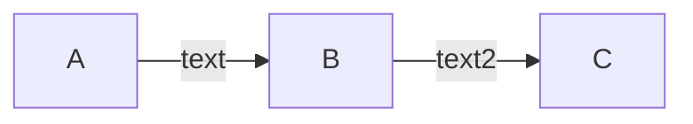

# Developer Documentation

This site is based on the [Hugo](https://gohugo.io/) framework for static website generation.

It uses the [Doks Theme](https://themes.gohugo.io/themes/doks/) for easy layouting, styling, and tooling.

## Handover notes

Please mind these items when taking over the developer docs.

### Font awesome

The docs use icons from a [Font awesome](https://fontawesome.com/) icon kit. It is included in `layouts/partials/head/script-header.html` as `<script src="https://kit.fontawesome.com/<kit-name>.js"></script>`.

Create a new free account and create your own kit, then change the `<kit-name>` to that one. Include all public icons in the kit.

You can find all the icons in the docs by looking for these kinds of usage:

- `<i class="fas`
- `<i class='fab`
- `(fa:fa-`

### Automation adjustments

This site auto-generates some content, see [automation](#automation). These adjustments are required.

- The parameter `hctlVersion` in `config/_default/config.toml` is updated based on the available releases in the `github.com/humanitec/hctl` repo by the `"gen-hctl-version"` script in `package.json` -> adjust the source repo here if it has changed.
- The parameter `canyonRunnerImageVersion` in `config/_default/config.toml` is updated based on the available releases in the `github.com/humanitec/humanitec-runner` by the `"gen-humanitec-runner-version"` script in `package.json` -> adjust the source repo here if it has changed.
- The pages underneath `content/platform-orchestrator/docs/use-cases` are autogenerated out of the content of the `humanitec/platform-orchestrator-use-cases/` repo -> adjust the repo in the `"gen-use-cases"` script in `package.json` if that repo has changed.
- The page `content/platform-orchestrator/docs/integrations/public-tf-modules.md` is auto-generated based on the existing public repos in the GitHub organization `humanitec-tf-modules` by the `"gen-tf-modules-page"` script in `package.json` -> adjust the organization in `gen/humanitec-tf-modules/gen-tf-modules-page.js` if that organization has changed.
- Place a GitHub personal access token (PAT) in an organization or repository secret named `GH_PAT` to be used by the GitHub workflows. The token needs the scopes required to perform the content auto-generation executed by the `.github/workflows/scheduled-generated.yml` workflow. Tip for local testing: set the token via the `GITHUB_TOKEN` environment variable and execute the `npm run gen-all` command to verify required permissions.

### Company name

The name "Humanitec" appears in a number of pages throughout the docs. While we have removed many mentions, remaining occurrences cannot be changed without knowing the replacement. E.g. to the email address "support@humanitec.com", the follow-up address is required.

-> Search for "humanitec" in all `.md` files and apply the appropriate replacement.

### CLI

The source and probably the name of the `htcl` are subject to change.

- Adjust the installation instructions on `content/platform-orchestrator/docs/integrations/cli.md` to use the new source
- Change all occurrences of `hctl` across all pages to the new name
- Adjust the `"gen-hctl-version"` script in `package.json` to pull the CLI version from its new source
- Rename the property `hctlVersion` globally

### Kapa.ai integration

To continue using [Kapa.ai](https://kapa.ai) as the search + AI assistant in the developer docs:

- Sign up and create your own Kapa tenant and project
- Create an integration ID and enter it as the `data-website-id` property in `layouts/partials/head/kapa-ai.html`
- Create an MCP server integration and enter its URL as the `KapaMCPknowledgeV2Url` property in `config/_default/config.toml`

To otherwise remove Kapa from the docs:

- Delete `layouts/partials/head/kapa-ai.html`
- Remove the block `{{ block "head/kapa-ai" . }}` from `layouts/partials/head/head.html`
- Remove the block `{{ block "search-section" . }}` from `layouts/_default/baseof.html`
- Remove the `KapaMCPknowledgeV2Url` property from `config/_default/config.toml`
- Delete all pages containing `*mcp*` in `content/platform-orchestrator/docs/integrations`
- Delete the mention of the MCP server from `content/platform-orchestrator/docs/updates/change-log.md`
- Delete the "MCP knowledge server" item from `data/landingcards.yaml`

### GitHub

These GitHub specific artefacts are included:

- `.github/dependabot.yml` to run Dependabot for automated dependency updates
- `.github/instructions/content.instructions.md` for using GitHub Copilot as a line-and-copy editor
- `.github/workflows/scheduled-generated.yml` to automatically trigger updates of generated content, see also [automation adjustments](#automation-adjustments)

When hosting this repo on any other service, you will need to find equivalents to those capabilities, and adjust those artefacts accordingly.

### Further changes

- Adjust the link target for the "Login" button in `layouts/partials/header/header.html` from the current value `https://console.humanitec.dev/auth/login`
- Adjust the `domainTLD` in `config/staging/params.toml` and `config/production/params.toml`
- If you wish to use the basic auth protected `staging` [environment](#environments) for preview/staging environments, define a new username/password combination and store it in the `nginx/staging/.htpasswd` file with the password encrypted. You can use the `htpasswd` shell utility or this online [htpasswd-generator](https://codeshack.io/htpasswd-generator/) for encryption
- Adjust all GitHub links pointing to Humanitec sources. Search for "`github.com/humanitec`" to find all occurrences
- Adjust the links to the Terraform/OpenTofu providers in `content/platform-orchestrator/docs/integrations/terraform-opentofu-providers.md`
- Consider pruning the "Change log" content in `content/platform-orchestrator/docs/updates/change-log.md`

## Requirements

- [Git](https://git-scm.com/) — latest source release
- [Node.js](https://nodejs.org/) — latest LTS version or newer
- [humctl](https://github.com/humanitec/cli) - latest release
- [Hugo](https://gohugo.io/installation) - latest release (optional)
- [dprint](https://dprint.dev/install/) - latest release (optional)

<details>

<summary>Why Node.js?</summary>

Doks uses npm (included with Node.js) to centralize dependency management, making it [easy to update](https://getdoks.org/docs/help/how-to-update/) resources, build tooling, plugins, and build scripts.

</details>

### 1. Get started

Download the repo.

```bash
git clone https://github.com/humanitec/developers-docs.git
```

### 2. Install dependencies

```bash
npm install
```

### 4. Start development server

```bash
npm run stage
```

While the running server blocks your terminal, it is recommended to use it like that to see live log output. Just open another terminal to continue.

Check the line saying `Web Server is available at //localhost:1313/ (bind address 127.0.0.1)` to find the URL to access the site on your system, hosted by your local server.

The server will observe the local file system and dynamically rebuild the site on any changes.

## Other commands

Doks comes with [commands](https://getdoks.org/docs/overview/commands/) for common tasks.

### Create a new document

```bash
npm run create -- --kind docs ./content/docs/some/folder/<file-name>.md
```

Folders can be whatever you want, as long as it is organized.

If you're creating a new folder, create an `_index.md` file first, followed by the content. The `_index.md` file will not have any content itself. It serves to name the section in the left nav bar through its `title` attribute, and the position of that section in the nav bar through its `weight` attribute.

```bash
npm run create -- --kind docs ./content/docs/some/folder/_index.md
npm run create -- --kind docs ./content/docs/some/folder/hello-world.md
```

### Create a new blog post

Note: we are not using the feature at the moment.

```bash
npm run create -- --kind blog blog/<folder>/<file-name>.md
```

### Commands

### lint

Check scripts, styles, and markdown for errors:

```bash
npm run lint
```

#### scripts

Check scripts for errors:

```bash
npm run lint:scripts [-- --fix]
```

#### styles

Check styles for errors:

```bash
npm run lint:styles [-- --fix]
```

#### markdown

Check markdown for errors:

```bash
npm run lint:markdown [-- --fix]
```

### clean

Delete temporary directories:

```bash
npm run clean
```

Clean cache:

```bash
yarn cache clean
yarn clean
```

### start

Start local development server:

```bash
npm run start
```

### build

Build production website:

```bash
npm run build
```

#### functions

Build Lambda functions:

```bash
npm run build:functions
```

#### preview

Build production website including draft and future content:

```bash
npm run build:preview
```

#### Docker

Build the container:

```bash
docker build -t "developer-docs" .
```

Run the container:

```bash
docker run -p 8080:80 --name developer-docs -e DOCS_ENV=staging developer-docs:latest
```

Then open http://localhost:8080/

### Format

Format the documentation:

```bash
yarn format
```

IF you get the following error:

```bash
error Command failed with signal "SIGSEGV".
# or
segmentation fault  dprint fmt
```

Clear dprint's cache:

```bash
dprint clear-cache
```

## SEO

By default, everything is set to

```html
<meta name="robot" content="index, follow" />
```

If you want to disable search engines for a page, just make sure to set `index: false` in the Front Matter section of the page, for example.

```
---
title: "My invisible page"
index: false
---
```

## Testing

### Smoke Test

Use these test steps to validate proper Hugo functionality after minor upgrades or fixes.

* For local testing: start the development server via `npm run stage`
* Select a Chromium-based browser, e.g. Chrome or Edge
* Open the start page at http://localhost:1313/ (local) or the preview environment
* Verify proper layout and styling
* Expand several levels of the left hand navigation
  * Verify proper layout
* Open any page using ``
  * Verify tabs functionality
* Open any page including a ` ```mermaid` diagram
  * Verify proper diagram display
  * Note: cut-off box labels may be a local effect. Verify using a new private tab, and verify against production
* Open any category of the example library
  * Apply any selection filter, verify the number of examples is reduced
  * Open one example and verify the proper structure and example file display

### E2E Test

Use these test steps to validate proper Hugo functionality after major upgrades, including a Hugo version change.

* For local testing: start the development server via `npm run stage`
* Select a Chromium-based browser, e.g. Chrome or Edge
* Open the start page at http://localhost:1313/ (local) or the preview environment
* Verify proper layout and styling
* Verify light mode/dark mode switcher functionality
* Expand several levels of the left hand navigation
  * Verify proper layout
  * Verify vertical scrolling once menu content exceeds available space
* Open any page with a TOC (right hand side)
  * Verify TOC navigation
* Open any page with code samples
  * Verify code display and "Copy" button functionality
* Open any page using `{{% details }}`
  * Verify expand/collape functionality
* Open any page using ``
  * Verify tabs functionality
  * Verify that tabs of the same name are opened in other tab groups
  * Verify that tabs of the same name are opened when opening another page
* Open any page using an embedded markdown image ``
  * Verify the proper layout and skew of the image
* Open at least three pages using ` ```mermaid` diagrams. On each page:
  * Verify proper diagram display
  * Note: cut-off box labels may be a local effect. Verify using a new private tab, and verify against production
* Open a page with an embedded video
  * Verify video playback (image and sound)
  * Use both picture-in-picture and fullscreen mode
* Open any category of the example library
  * Verify the example selection filter. Make sure to combine filters
  * Open one example and verify the proper structure and example file display
* Open a page with an external link
  * Verify the correct link layout (icon)
  * Verify it opens in a new tab

Repeat all steps with a non-Chromium-based browser, e.g. Firefox or Safari.

# Authoring Guide

## Using GitHub Copilot

Invite GitHub Copilot to review PRs on this repository.

The folder `.github/instructions` contains specific instructions for Copilot Agent runs:

- `.github/instructions/content.instructions.md`: Line and copy editing instructions to improve styling, grammar, punctuation, and formatting

## Branching

Create your own Git branch to work in. Name the branch after the ticket if applicable, e.g. "`docs-123`".

Publishing and pushing to the branch will trigger the configured [automation](#automation).

## Basic formatting

Use standard markdown to format your content.

## Headings

Use heading level 2 ("`## Some Heading`") and below. Do not use level 1 as that is reserved for the top page title. All level 2 headings will be displayed in the TOC on the right hand side of the page.

## Links

Use standard markdown for

- external links: `[Some link](https://example.com/some/page)`
- anchor links to headings on the same page: `[Some heading link](#heading-name)`

Use the `` shortcode for links to other pages of this site. Hugo verifies their validity and will fail the site build on errors, protecting against broken links.

Use link targets relative to the `content` directory, with or without the file extension. Anchor links and URL parameters are supported as shown:

- `[Some other page]()`
- `[Some other page]()`
- `[Some other page]()` No trailing "/" before the "#"
- `[Some other page](?param1=value1)` Place URL parameters outside of the `` shortcode

While link targets relative to the current page also work, we recommend using links starting with `/docs` to be robust against page restructurings.

External links, i.e. all links having a target starting with "`http`", will be rendered to open in a new window and display an icon. See the override file `layouts/_default/_markup/render-link.html` for the implementation. Remove this file to revert to Hugo standard rendering.

## Callouts

Create callout boxes using the `` shortcode, e.g.

```

This is some info text. You can use standard **markdown** here.

```

Use the `context` attribute to choose a style. This will automatically change the icon as well. Choose from `info`, `caution`, `warning`, `failure`, and `success`. Defaults to `info` if omitted.

## Code blocks

Use markdown code blocks indicating the language for proper syntax highlighling. A "Copy" to clipboard button will automatically be generated in the rendered output.

````
```yaml
some:
  yaml:
    content: here
```
````

## Tab groups

Create an interactive tab group using the `` shortcode, e.g.

```

{}

Tab 1 content, supporting **markdown**.

{}
{}

Tab 2 content, supporting **markdown**.

{}

```

[Callouts](#callouts) are currently not supported inside tabs. As a workaround, use `` instead of ``.

## Mermaid Diagrams

Hugo supports including [Mermaid diagrams](https://mermaid.js.org/) in pages.

To enable a page for Mermaid, add `mermaid: true` to the front matter variables (between the `---` delimiters at the top).

Embed a chart like this:

````

````

Resources:

- [Mermaid user docs](https://mermaid.js.org/intro/)
- [Mermaid live editor](https://mermaid.live/)
  - Creates permalinks for any edit for re-use and sharing!

Styling:

Edit the `data/mermaid.json` file to change the default styling of Mermaid diagrams for both light and dark themes.

You can find all available options in the [Mermaid theming documentation](https://mermaid.js.org/config/theming.html#theme-variables). Also take a look at the [Color and Color Calculation](https://mermaid.js.org/config/theming.html#color-and-color-calculation) section.

These images help you identify the style you need:

Flowcharts:


Sequence diagrams:


### Predefined styles

There are some predefined custom styles you can easily apply in your diagrams. They are defined in [./assets/scss/components/\_mermaid.scss](./assets/scss/components/_mermaid.scss) for light mode and [./assets/scss/common/\_dark.scss](./assets/scss/common/_dark.scss) for dark mode (look for the "Custom styles" comment).

To apply them, use the `class` directive in a diagram. E.g. to apply the style `.highlight` to an element, add:

```
class my-element highlight
```

or attach the style to the element itself (not supported in Mermaid for all elements, specifically not for subgraphs):

```
my-element(My Element label):::highlight
```

## Autogenerated content

Some content is autogenerated from metadata and external sources. See the separate [README](./gen/README.md) for details.

## Navigation

### Navigation items as links

You can create items in the left navigation bar that link to another page, not having content of their own. To do so, create a regular `.md` page and add the `navTarget` frontmatter attribute like this:

```yaml
---
navTarget: /slug/of/target/page
---
```

Any page with that property have its navigation item rendered as a link to that target. In addition, the page itself will receive `<meta http-equiv="Refresh">` header to that target in case its own URL should be opened.

## Development Lifecycle

### Hosting

To host the developer docs, [build the image](#docker) and use it to run a container in a container runtime of your choice, e.g. Kubernetes. The container will listen on port 80. You will need to arrange HTTP routing and a TLS certificate separately.

### Environments

Two versions of the site, `production` and `staging`, are built into the same image (in 2 different html folders). Check the DOCKERFILE for details. The environment variable `DOCS_ENV` controls which version is shown. `staging` is password protected, with the encrypted password stored in `nginx/staging/.htpasswd`.

### Automation

The GitHub workflow `.github/workflows/scheduled-generated.yml` performs a daily run to update a number of generated elements. See the workflow for details.

## Documentation

- [Hugo](https://gohugo.io/documentation/)
- [Hugo configuration](https://gohugo.io/getting-started/configuration)
- [Doks](https://getdoks.org/)
