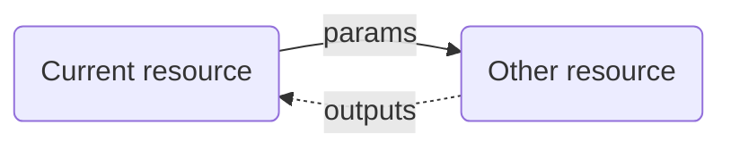
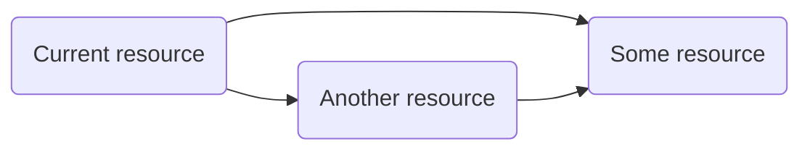
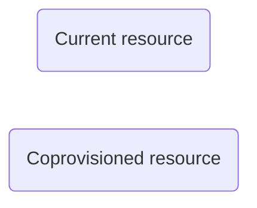
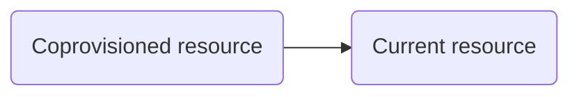
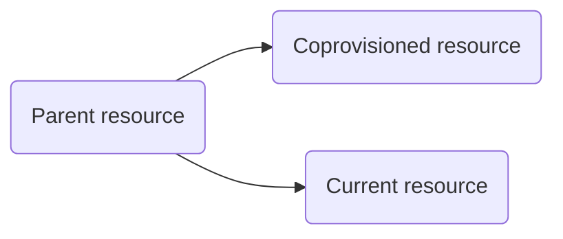
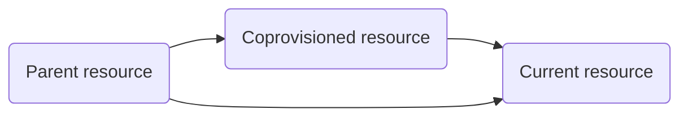

{}

{}



The Orchestrator matches each request for a resource to a module which defines the Terraform/OpenTofu source code that should be used to provision it. Each module may also further expand the [resource graph]() by defining dependency and coprovisioned resources that add additional nodes and edges to the resource graph. Once all nodes in the resource graph are matched to a module, a final Terraform file is generated internally and executed in the [runner]() to provision the environment.

Modules can reference source code from either remote locations, files mounted in the _runner_, or inline source code stored in the Orchestrator itself.

## Basic Example

The most basic module only needs to define a resource type and a source for the Terraform/OpenTofu code. In this example, this module may provision a Kubernetes namespace using source code in the `github.com/acme-org/module-library` repository (if it were to exist). The module source references a module in a subdirectory using the `//` notation.


{}

```hcl
resource "platform-orchestrator_module" "my-namespace-module" {
  id            = "my-namespace-module"
  resource_type = "k8s-namespace"
  module_source = "git::https://github.com/acme-org/module-library//my-namespace-module"
}
```

{}
{}

```
octl create module my-namespace-module \
  --set resource_type=k8s-namespace \
  --set module_source=git::https://github.com/acme-org/module-library//my-namespace-module
```

{}


## Configuration

A module configuration consists of these elements:


{}

Refer to the resource schema in the [Terraform](https://registry.terraform.io/providers/humanitec/platform-orchestrator/latest/docs/resources/module#schema) or [OpenTofu](https://search.opentofu.org/provider/humanitec/platform-orchestrator/latest/docs/resources/module#schema) module documentation.

{}

{}

{}

{}
{}

```yaml
# User-supplied unique module id
id: my-module

# The resource type this module matches
resource_type: my-resource-type

# Optional module description
description: My module description

# Specify the module source as either a supported URI or set to 'inline' if you're using module_source_code
module_source: git::https://github.com/organization/repository//sub/directory

# Optional inline module source code, 2000 characters max, when module_source is 'inline'
module_source_code: |
  # Inline Terraform/OpenTofu code
  variable "input_var" {}

# Optional map of provider mappings
provider_mapping:
  google: google.us-central-1

# Optional map of input params supported when requesting or using the resource backed by this module.
# These are passed in as variables to the module code.
module_params:
  key:
    type: string
    is_optional: false
    description: An input value that must be specified when requesting this resource module

# Optional map of additional module inputs to pass in to variables in the module code
module_inputs:
  input_var: "some-value"

# Optional map of dependencies
dependencies:
  other-resource:
    type: my-other-resource-type

# Optional list of coprovisioned resources
coprovisioned:
- type: some-resource-type
```

{}


Refer to the individual sections below for more details.

## The resource type

The module must be linked to a [resource type]() that has already been configured in the Orchestrator. The resource type indicates what kind of behavior and outputs this module provides as its external contract in the resource graph.

The outputs of a module are provided by the Terraform/OpenTofu `output` blocks in the module source. The Orchestrator cannot validate whether these match the contract of the resource type, but errors will be thrown during deployment if an output expected by the resource type is not provided by the module.

## Module source locations

The module source must be valid OpenTofu or Terraform source code. For more information about writing modules, refer to the [OpenTofu Modules](https://opentofu.org/docs/language/modules/) and [Terraform Modules](https://developer.hashicorp.com/terraform/language/modules) documentation.


By default, the Orchestrator executes using OpenTofu and any modules must be compatible with the open source OpenTofu project.


A module may define its source using the `module_source` field with a registry address, git URL, mounted-file source, or using inline Terraform/OpenTofu code in the `module_source_code` field when the `module_source` is set to "inline".

### OpenTofu / Terraform module registries

You can use a module published to an accessible registry such as the [OpenTofu registry](https://search.opentofu.org/modules) or [public Terraform registry](https://registry.terraform.io/browse/modules).


{}

```hcl
  # General pattern
  module_source = "(<HOSTNAME>/)<NAMESPACE>/<NAME>/<PROVIDER>(@version)"

  # Use opentofu registry by default
  module_source = "azure-terraform/hashicorp-vault/azurerm"

  # Specify the registry hostname
  module_source = "registry.opentofu.org/azure-terraform/hashicorp-vault/azurerm"

  # Use a private source
  module_source = "app.terraform.io/azure-terraform/hashicorp-vault/azurerm"
```

{}
{}

```yaml
# General pattern
module_source: (<HOSTNAME>/)<NAMESPACE>/<NAME>/<PROVIDER>(@version)

# Use opentofu registry by default
module_source: azure-terraform/hashicorp-vault/azurerm

# Specify the registry hostname
module_source: registry.opentofu.org/azure-terraform/hashicorp-vault/azurerm

# Use a private source
module_source: app.terraform.io/azure-terraform/hashicorp-vault/azurerm
```

{}


If you're using a private registry that requires authentication, see [private module sources]() for instructions.

To use a specific version, you may append `@vX.Y.Z` to the end of the `module_source`.


{}

```hcl
  module_source = "azure-terraform/hashicorp-vault/azurerm@v1.1.0"
```

{}
{}

```yaml
module_source: azure-terraform/hashicorp-vault/azurerm@v1.1.0
```

{}


Multiple uses of the same module source address within a resource graph can specify different versions in their module configuration.

### Git sources


Git sources are recommended whenever possible since they support multiple files, leading to better organization, and allow for better testing and CI/CD in production settings. E.g. you may use CI/CD tooling to validate and test modules in isolation.


Module source can be pulled from a git repository using either HTTP or SSH protocols by specifying the `git::ssh://` or `git::https://` prefixes. For example:


{}

```hcl
  module_source = "git::https://github.com/organization/repository"

  module_source = "git::https://bitbucket.org/organization/repo//sub/directory"

  module_source = "git::ssh://username@host.com/repo.git"

  module_source = "git::ssh://git@github.com/repo.git//sub/directory"
```

{}
{}

```yaml
module_source: git::https://github.com/organization/repository

module_source: git::https://bitbucket.org/organization/repo//sub/directory

module_source: git::ssh://username@host.com/repo.git

module_source: git::ssh://git@github.com/repo.git//sub/directory
```

Note that unlike in Terraform/OpenTofu, bare `github.com` or `bitbucket.org` domains must still use the `git::` prefixes to avoid conflict with other source types.

{}


The target repository or directory is expected to contain valid `.tf` files describing a Terraform/OpenTofu module.

Git sources may define a target branch, or tag name using the `ref` query argument on the url:


{}

```hcl
  module_source = "git::https://github.com/organization/repository?ref=v1-preview"
```

{}
{}

```yaml
module_source: git::https://github.com/organization/repository?ref=v1-preview
```

{}


If the module source uses an SSH protocol and requires an SSH key to fetch it, see [private module sources]() for instructions.

### Mounted files

Alternatively, module source can be pulled from a directory available within the [runner]() container. This requires customization of the runner configuration to mount additional files and volumes at runtime but can allow for more complex environment-dependent configurations.

Mounted file sources are defined through a `/` prefix.


{}

```hcl
  module_source = "/mnt/some/directory/here"
```

{}
{}

```yaml
module_source: /mnt/some/directory/here
```

{}


Mounted file sources do not support any kind of version reference.

### Inline code

For short modules, demos, or testing, you may wish to store the module source code in the Orchestrator itself through the `module_source_code` field. This supports a multiline Terraform/OpenTofu formatted string to define the module.

A maximum of 10,000 characters is supported.


{}

```hcl
  module_source      = "inline"
  module_source_code = <<EOT
variable "input_var" {
  type = string
}

resource "random_id" "example" {
  length = 10
}

output "value" {
  value = random_id.example.hex
}

output "platform_orchestrator_metadata" {
  value = {
    "Example-Key" = "example value"
  }
}
EOT
```

{}
{}

```yaml
module_source: inline
module_source_code: |
    variable "input_var" {
      type = string
    }

    resource "random_id" "example" {
      length = 10
    }

    output "value" {
      value = random_id.example.hex
    }

    output "platform_orchestrator_metadata" {
      value = {
        "Example-Key" = "example value"
      }
    }
```

{}


### Switching the module source

Modules support updating the `module_source` at any time. This only influences how the contents are pulled at deployment time and will not cause the resource to be recreated or deleted unless the Terraform resources defined within the source content change.

## Provider mapping

{}

{}

{}

{}

## Module params

If the module source defines Terraform/OpenTofu variables through `variable` blocks, the module may expect them to be set by the resource consumer in the `params` section in a workload manifest or by [dependencies](#dependencies) or [coprovisioning](#coprovisioned-resources) in the resource graph.

`module_params` is defined as a structure, for example:


{}

```hcl
  module_params = {
    required_var = {
      type        = "type"
      description = "Some required variable"
    }
    optional_var = {
      type        = "number"
      is_optional = true
      description = "Some optional variable"
    }
  }
```

{}
{}

```yaml
module_params:
  required_var:
    type: string
    description: Some required variable
  optional_var:
    type: number
    is_optional: true
    description: Some optional variable
```

{}


Supported types are `string`, `number`, `bool`, `list`, `map`, or `any`. Only basic validation is performed on values known at graph creation time. Any further type or constraint validation should be done from within the code.

Note, if you don't specify a supported parameter here, any unexpected keys or types will cause deployment errors.

## Module inputs

If the module source defines other Terraform/OpenTofu variables through `variable` blocks that need to be configured, you may wish to set the value in the module definition directly.

`module_inputs` is defined as a structure, for example:


{}

```hcl
  module_inputs = jsonencode({
    input_var = "Some literal string"
    complex_variable = {
      key = "value"
    }
    example_a = "$${bare-placeholder}"
    example_b = "an $${interpolated-placeholder} within a string"
  })
```

{}
{}

```yaml
module_inputs:
  input_var: Some literal string
  complex_variable:
    key: value
  example_a: "${bare-placeholder}"
  example_b: "an ${interpolated-placeholder} within a string"
```

{}


The structure may contain objects, arrays, strings, booleans, numbers, and null values. These are passed through along with the `module_params` to the module source code.

Note, the same key cannot be specified in both `module_params` and `module_inputs`. If you wish to have a fallback default value set by the platform engineer this should be handled in the source code itself.


Do not place secret values in module inputs. They will be accessible to anyone with read access on the module.


### Placeholder support in module inputs

Module inputs also support [placeholders]() inside strings using the `${` prefix and `}` suffix. Module inputs support context placeholders, resource placeholders, and selector placeholders.

If the placeholder is the only content of the string, as in `example_a` above, then the expression type is maintained and passed through to the module. So if the expression referenced an integer value, the variable would be set as an integer. Similarly with objects, arrays, booleans, and null values. However, if the expression is surrounded by other string literal content, then the referenced value will be encoded as JSON before being embedded in the string.

## Dependencies

While the Terraform/OpenTofu source code backing a module allows it to provision arbitrarily complex resources, modules are most efficient if they consume and subsume behaviour from dependency resources and other nodes in the [resource graph]().

The `dependencies` map allows a module to specify other resources that must be provisioned before the current resource. Dependencies thus effectively create additional resources.

The current resource may then use placeholders in the `module_inputs` to refer to outputs of these dependencies. This is the core of the resource graph: a resource that has a dependency on another resource is represented by two nodes joined by a directional edge.



Each dependency is specified by an alias key and a [resource type]() with optional [resource ID](), [resource class](), and resource parameter settings:


{}

```hcl
  dependencies = {
    some-alias = {
      type  = "some-resource-type"
      class = "optional-resource-class"
      id    = "optional-resource-id"
      params = jsonencode({
        key = "value"
      })
    }
    another-alias = {
      type = "another-resource-type"
      params = jsonencode({
        ref = "$${resources.some-alias.outputs.x}"
      })
    }
  }
```

{}
{}

```yaml
dependencies:
  some-alias:
    type: some-resource-type
    class: optional-resource-class
    id: optional-resource-id
    params:
      key: value
  another-alias:
    type: another-resource-type
    params:
      ref: "${resources.some-alias.outputs.x}"
```

{}


The alias, "some-alias" in the example above, is used as a local name within the module. This alias may be used in [resource placeholders]() to refer to this dependency. For example, `${resources.some-alias.outputs.x}`.

The resource type must be a resource type available within the deployment environment. If it cannot be matched to a module, the graph construction will fail with a related error.

Using a resource placeholder in the `params` for another resource creates a dependency in the resource graph between the two resources. The example shown above will yield this graph:



### Resource classes in dependencies

A dependency may use the `class` property to specify a [resource class](). It defaults to a class of `default` if not provided.

The symbol `@` may by used to signify the current resource's class. For example, if the current resource was a type `postgres` of class `standard`, a dependency with class `@-beta` would resolve to a class of `standard-beta`.

The same conventions apply for resource classes in [coprovisioning (below)](#coprovisioned-resources).

### Resource IDs in dependencies

A dependency may use the `id` property to specify a [resource ID](). It defaults to inheriting the `id` of current resource but can be specified as any fixed value.

Like the class, the `@` symbol can be used to modify the inherited ID. For example, if the current resource had an ID of `main`, a dependency with ID `@-primary` would resolve as `main-primary`.

### Resource uniqueness

{}


Two dependencies in separate resources using the same type, class, and ID, will refer to the same resource which is then only added to the graph once.


## Coprovisioned resources

A module may use coprovisioned resources to add resources to the [graph]() that are dependent on the current resource, or just to ensure they exist somewhere in the graph.

Coprovisioned resources are defined as a list in the `coprovisioned` section of a module. They do not have an alias and cannot be used in resource placeholders.


{}

```hcl
  coprovisioned = [
    {
      type  = "some-resource-type"
      class = "optional-resource-class"
      id    = "optional-resource-id"
      params = jsonencode({
        key = "value"
      })
      is_dependent_on_current      = false
      copy_dependents_from_current = false
    }
  ]
```

{}
{}

```yaml
coprovisioned:
- type: some-resource-type
  class: optional-resource-class
  id: optional-resource-id
  params:
    key: value
  is_dependent_on_current: false
  copy_dependents_from_current: false
```
{}


Like the resources in `dependencies`, coprovisioned resources also have a [resource type](), [resource ID](), [resource class](), and resource parameters property. These operate with the same conventions as dependencies including support for `@` referencing the current resource.

By default, coprovisioned resources are added as nodes to the resource graph with no relation or edge to the current resource node.



The `is_dependent_on_current` and `copy_dependents_from_current` booleans may be used to anchor them.

`is_dependent_on_current: true` adds a dependency relationship between the coprovisioned resource and the current resource so that the current resource must be provisioned before the coprovisioned one. This may be used because the coprovisioned resource has placeholders that may refer to outputs of the current node.


`copy_dependents_from_current: true` takes effect after the resource graph has been created. This flag makes all resources that depend on the current resource also depend on the coprovisioned resource.



Setting both flags to `true` will yield this graph:





You may pass outputs from the current or from other resources to co-provisioned resources, as well as other dynamic values. See [placeholder expressions]() for a full list.



## Metadata

A module may optionally expose _metadata_ for the resources provisioned via the module. Metadata are selected attributes of the real-world resource which you consider useful for your platform engineers, developers, or connected systems to see.

You define metadata by using the reserved TF output name `platform_orchestrator_metadata` in the TF code of your module, referring to other TF values as needed:

```hcl
output "platform_orchestrator_metadata" {
  value = merge(
    {
      "Kubernetes-Namespace" = var.namespace
    },
    {
      "Kubernetes-Deployment" = var.deployment-name
    }
  )
}
```

The Orchestrator console displays resource metadata when selecting an active resource in the resource graph. Values in URL format are automatically served as links:


The output of the CLI command `octl get active-resource-nodes` also returns the metadata when adding the `-o json` or `-o yaml` flag.


Avoid exposing confidential or sensitive information as metadata. It will be accessible to anyone with read access to the environment.

You cannot use TF data marked as `sensitive` in the metadata. Declaring the `platform_orchestrator_metadata` itself as `sensitive` will make deployments fail by design.

