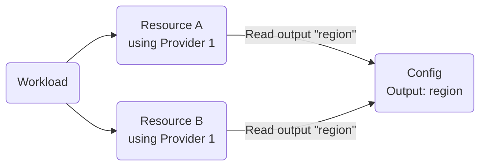

{}

{}



Passing providers into modules is a standard TF mechanism and implemented by the Orchestrator through:

1. Defining Orchestrator providers
2. Passing the providers into the Orchestrator [modules]() that require them via a `provider_mapping`

TF providers control access of your TF modules to the real world infrastructure. Managing provider configurations centrally via the Orchestrator helps control and configure that access at any scale.

{}

## Basic Example

Let the TF code of a [module]() declare a required provider [hashicorp/aws](https://registry.terraform.io/providers/hashicorp/aws/latest):

```hcl
terraform {
  required_providers {
    aws = {
      source  = "hashicorp/aws"
      version = "~> 6"
    }
  }
}
```

A configured provider needs to be passed in to the module. A common use case at this point is specifying a target `region` in the `hashicorp/aws` provider. To achieve that goal, define a provider in the Orchestrator:


{}

```hcl
resource "platform-orchestrator_provider" "aws-us-east-1" {
  id                 = "aws-us-east-1"
  description        = "AWS resources in the us-east-1 region"
  provider_type      = "aws"
  source             = "hashicorp/aws"
  version_constraint = "~> 6.26.0"
  configuration = jsonencode({
    region = "us-east-1"
  })
}
```

{}
{}

```bash
octl create provider kubernetes aws-us-east-1 --set-yaml=@provider.yaml
```

where `provider.yaml` is:

```yaml
description: AWS resources in the us-east-1 region
source: hashicorp/aws
version_constraint: ~> 6.26.0
configuration:
  region: us-east-1
```

{}


Pass the provider in to the module via a `provider_mapping` (more details [here](#provider-mapping)):


{}

```hcl
resource "platform-orchestrator_module" "some_aws_resource" {
  # ...
  provider_mapping = {
    aws = "aws.aws-us-east-1"
  }
}
```

{}
{}

```bash
octl create module some-aws-resource --set-yaml=- <<"EOF"
# ...
provider_mapping:
  aws: aws.aws-us-east-1
EOF
```

{}


The Orchestrator will then generate the required TF code for a deployment out of this configuration. See [providers in the generated TF code](#providers-in-the-generated-tf-code) further down for the details.

You can find more examples in the [examples](#examples) section.

## Configuration


{}

Refer to the resource schema in the [Terraform](https://registry.terraform.io/providers/stellwerk-labs/platform-orchestrator/latest/docs/resources/provider#schema) or [OpenTofu](https://search.opentofu.org/provider/stellwerk-labs/platform-orchestrator/latest/docs/resources/provider#schema) provider documentation.

{}
{}

A provider consists of these elements:

```yaml
# User-supplied provider type and unique id. The provider_type can be anything
# but it is recommended that you use the provider name
provider_type: kubernetes
id: dev-k8s-cluster

# Optional provider description
description: My provider description

# Provider source as an OpenTofu registry coordinate
source: hashicorp/kubernetes

# The version constraint to pull for the provider
version_constraint: '~> 2.0'

# The configuration of the provider. Available properties depend on the provider type
configuration: {}
```

{}


The sections below have more details on each configuration element.

## Provider source

The `source` of the provider is interpreted the same as the `source` address in the `required_providers` block used by [Terraform](https://developer.hashicorp.com/terraform/language/providers/requirements#source) / [OpenTofu](https://opentofu.org/docs/language/providers/requirements/#source-addresses).

Source addresses consist of two or three parts: `[HOSTNAME/]NAMESPACE/TYPE`.

* The optional `hostname` of the registry that distributes the provider. If omitted, this defaults to `registry.opentofu.org` but you can set this to `registry.terraform.io` if you're using a provider only available in the Terraform registry

* The required `namespace` part is the organizational namespace within the specified registry

* The required `type` is the short name of the provider. The `type` is usually the providers preferred local name and may also be used as the `provider_type`

Examples:

- `hashicorp/random`: resolves to `registry.opentofu.org/hashicorp/random`

- `registry.terraform.io/hashicorp/random`: explicitly use the `hashicorp/random` provider from the Terraform registry

- `myown.registry.com/hashicorp/random`: use the `hashicorp/random` provider from your privately hosted provider registry at `myown.registry.com`

## Provider mapping

{}

## Version constraint

Most providers have multiple available versions and will increment as resources are added over time or bugs are fixed. You must specify a version constraint when you register a provider

* `~>` allows only the rightmost version component to increase. For example, `~> 1.2.3` allows for versions greater or equal to `1.2.3` and less than `1.3`

* `=` allows for only the exact version number

* `!=` excludes an exact version number, often used when a known version has a bug you want to avoid

* `>`, `>=`, `<`, `<=` enforce additional constraints

You can specify multiple expressions separated by commas: `>= 1.2.0, < 2.0.0`

During a deployment, the TF executable in the runner will download exactly one version of a TF provider (as identified by its `source`), honoring the combined version contraints for this provider present in the deployment graph:

- The `required_providers` blocks of all modules used in the deployment
- The `source` attributes of all Orchestrator providers with a [provider mapping](#provider-mapping) to any module used in the deployment


These version constraints must overlap. If the deployment cannot resolve a single unique provider version, an error will be returned. For this reason, it's best to use loose constraints like `~>` and `=>` when possible.


## Provider configuration

You can find the documentation for each provider on its page in the registry. Configuration properties are set in the `provider` block and are frequently used to specify both authentication and contextual properties of the provider. These properties are set in the `configuration` map of the Orchestrator provider object.
For example, to achieve this provider configuration:

```
provider "aws" {
  region = "us-east-1"
}
```

provide this `configuration` in the Orchestrator provider:


{}

```hcl
resource "platform-orchestrator_provider" "aws-us-east-1" {
  id            = "aws-us-east-1"
  configuration = jsonencode({
    region = "us-east-1"
  })
  # ...
}
```

{}
{}

```yaml
...
configuration:
  region: us-east-1
```

{}



The Platform Orchestrator does not treat provider configuration as secret. Any secret values such as passwords, api keys, or private keys should be mounted as environment variables or files in the [runner]() and then only referenced in the provider configuration. See [using runners to configure providers](#using-runners-to-configure-providers) for details.


You can make provider configuration more flexible by using placeholders as shown in [this example](#pull-provider-configuration-from-a-central-config-resource).

## Providers in the generated TF code


This section describes an advanced topic you do not usually need to dive into to use providers. Refer to it for debugging purposes and validating your provider setup in detail.


To execute a [deployment](), the Orchestrator generates a TF file made up of a root module plus child modules for all [modules]() which are part of the deployment. You can view the generated TF file via the `octl get tf <deployment-id>`.

Providers are handled in this TF file as follows:

- All `required_providers` blocks in modules are used as-is and be present in the child modules of the root module
- For each [`provider_mapping` in a module](#provider-mapping), the data from the mapped Orchestrator provider is used to
  1. Create an entry in the `required_providers` block in the root module including `source` and `version`
  2. Create a `provider` block in the root module including the provider `configuration`
  3. Pass the mapped provider into the child module using a `providers` block

{}

For the [basic example](#basic-example) from above, the TF code in the root module will like this with respect to providers:

```hcl
terraform {
  required_providers {
    aws-aws-us-east-1-0fcc355f = {
      source  = "hashicorp/aws"
      version = "~> 6.26.0"
    }
  }
}

provider "aws-aws-us-east-1-0fcc355f" {
  alias  = "aws-aws-us-east-1-0fcc355f"
  region = "us-east-1"
}

# The TF source code of this and all other modules must not contain any "provider" blocks
module "some-aws-resource_generated_module_name" {
  providers = {
    aws = aws-aws-us-east-1-0fcc355f.aws-aws-us-east-1-0fcc355f
  }
  # ...
}
```

{}

For any TF provider (identified by its `source`), there must be a version overlap for all occurrences of that provider in the `required_providers` blocks across the root module and all child modules. See [version constraint](#version-constraint) for details.

{}

## Multiple providers in the graph

At deploy time, the Orchestrator will combine the module sources, i.e. the TF code of all modules involved, into a single code structure to `apply` as shown in the previous section. The same type of `provider` may therefore appear more than once in that code in different modules. This is a supported and common setup. You can find deeper insights [here](#providers-in-the-generated-tf-code).

Many providers can be configured through environment variables present in the runner. This can be beneficial when you are configuring the provider depending on the runner being used to execute it.

However, these environment variables may also cause unexpected effects on providers in the combined code that share the same variables, or when multiple different configurations of the provider are used in the same graph.

Instead of using the standard environment variables supported by the provider, we therefore recommend that you rely on values coded into the provider definition, mounted file paths, or placeholder expressions as mentioned below.

## Using runners to configure providers

Many TF providers can automatically draw some configuration from their execution environment, often from environment variables or well-defined file locations. For example, the `hashicorp/aws` provider can obtain [authentication and configuration](https://registry.terraform.io/providers/hashicorp/aws/latest/docs#authentication-and-configuration) from a number of environment sources. Using these mechanisms eliminates the need for further explicit provider configuration, making the setup both simpler and more secure.

In the Orchestrator context, configure the compute for your [runners]() so that it provides the required configuration. For example, configure the clusters operating a [kubernetes-agent]() type runner to use the workload identity mechanisms of a cloud provider.

Refer to each [runner type]() for details.

If the provider does not offer a way to use values from the environment, you may provide configuration via another Orchestrator resource as shown in [this example](#pull-provider-configuration-from-a-central-config-resource).

## Setting provider blocks

By default, configuration is set as HCL / OpenTofu language attributes (`A = B`). To set provider configuration properties that are blocks, you may use a `[N]` suffix on the property key. For example, you could configure the `aws` provider with two assume role blocks to achieve chained role assumption:


{}

```hcl
resource "platform-orchestrator_provider" "my-provider" {
  source             = "hashicorp/aws"
  configuration      = <<EOT
{
  "region": "us-west-2",
  "assume_role[0]": {
      "role_arn": "arn:aws:iam::123456789012:role/SomeRole"
  },
  "assume_role[1]": {
      "role_arn": "arn:aws:iam::123456789012:role/AnotherRole"
  }
}
EOT
  # ...
}
```

{}
{}

```yaml
source: hashicorp/aws
configuration:
  region: us-west-2
  assume_role[0]:
    role_arn: arn:aws:iam::123456789012:role/SomeRole
  assume_role[1]:
    role_arn: arn:aws:iam::123456789012:role/AnotherRole
# ...
```

{}


Doing so will result in the following HCL /OpenTofu language at execution time with two separate `assume_role` blocks:

```hcl
provider "aws" {
    region = "us-west-2"
    assume_role {
        role_arn = "arn:aws:iam::123456789012:role/SomeRole"
    }
    assume_role {
        role_arn = "arn:aws:iam::123456789012:role/AnotherRole"
    }
}
```

## Placeholders in provider configuration

You can use [placeholders]() in the provider `configuration` to set dynamic values. Providers support context, var, and resource placeholders.

Context placeholders can be effective to specify global but environment dependent behavior in a provider. For example, the `hashicorp/aws` provider supports a `default_tags` property which tags all resources provisioned by the provider. Using context placeholders here allows you to reference the environmental source of the provisioned infrastructure.

```yaml
configuration:
  default_tags[0]:
    tags:
      OrgId: ${context.org_id}
      ProjectId: ${context.project_id}
      EnvId: ${context.env_id}
```

Var placeholders can be used to securely reference environment variables as input to the provider. Here, you would set the `TF_VAR_DEFAULT_AWS_ACCESS_KEY` environment variable within the runner.

```yaml
configuration:
  access_key: ${var.DEFAULT_AWS_ACCESS_KEY}
```

And resource placeholders can be used if the module that uses the provider defines a dependency with the correct key. For example, the `cyrilgdn/postgresql` provider, is configured to the specific instance where database queries will be executed. Here a resource placeholder can be used if the module using the provider has an `instance` dependency.

```yaml
source: "cyrilgdn/postgresql"
version_constraint: "~> 1.0"
configuration:
    host: ${resources.instance.outputs.hostname}
    port: ${resources.instance.outputs.port}
    username: ${resources.instance.outputs.username}
    password: ${resources.instance.outputs.password}
```

[This example](#pull-provider-configuration-from-a-central-config-resource) illustrates another use of placeholders in the provider configuration.

## Lifecycle

You can create and manage providers using the [octl CLI](), [Terraform provider](https://registry.terraform.io/providers/stellwerk-labs/platform-orchestrator/latest/docs/resources/provider), [OpenTofu provider](https://search.opentofu.org/provider/stellwerk-labs/platform-orchestrator/latest/docs/resources/provider), or [API]().

{}

## Renaming and deleting providers

A provider cannot be renamed or deleted as long as it is used in an active [deployment](). The reason being that the provider is referenced in the Terraform/OpenTofu state file, and renaming or deleting it would break the state.

To rename a provider, follow these steps:

1. Create a new provider with a new name
2. Update the [provider mapping]() on all modules to use the new provider
3. Run a new deployment on all environments that are using one of these modules. The old provider will now be removed from the state files
4. Delete the provider with the old name

To delete a provider, follow these steps:

1. Remove the [provider mapping]() on all modules using the provider
2. Run a new deployment on all environments that are using one of these modules. The old provider will now be removed from the state files
3. Delete the provider

## Executable dependencies

Some providers or provider configurations may require executables within the [runner]() container. Some examples of these are:

* A Kubernetes provider using the `exec` block may expect to use the `aws` CLI to generate a suitable session token

* A postgresql provider for connecting to databases may require the `psql` CLI

* A provider that uses `ansible` to interact with remote systems may need `ansible` and `ssh`

These executables are not present by default in the runner container image used by the Platform Orchestrator. For security reasons, the default image is minimal and does not contain any executables other than the runner and OpenTofu.

If you need additional executables, it is best to publish and use a [customized runner image](). Alternatively, you may install them during execution by running as a root user and using a local exec block to install required packages, although this is not recommended.

## Examples

### Pull provider configuration from a central config resource

Configure providers dynamically per environment or project to achieve standardization in your cloud estate, for example by defining a common target region.

{}

With usually more than one resource present in the [resource graph]() for a deployment, a common pattern is to externalize shared configuration values into a centralized `config` resource. Other resources may then read outputs of that `config` using a [resource placeholder]().



In this example, the modules of both Resources A and B are using the same Provider 1 via a [provider mapping](#provider-mapping). That provider must be configured for a "region", such as the [`hashicorp/aws` provider](https://registry.terraform.io/providers/hashicorp/aws/latest). We want resources A and B to be provisioned into the same region.

To implement this setup, define a provider using a [resource placeholder]() to obtain the `region` from the output of a `config` resource:

```hcl
resource "platform-orchestrator_provider" "aws" {
  id                 = "aws"
  description        = "AWS provider"
  provider_type      = "aws"
  source             = "hashicorp/aws"
  version_constraint = ">= 6.25.0"
  configuration = jsonencode({
    region = "$${resources.config.outputs.region}"
  })
}
```

Provide a resource type and module for the `config` resource like this:

```hcl
resource "platform-orchestrator_resource_type" "example_config" {
  id          = "example-config"
  description = "Example resource type for a config"
  output_schema = jsonencode({
    type = "object"
    properties = {
      region = {
        type        = "string"
        description = "The AWS region where to provision resources"
      }
    }
  })
  is_developer_accessible = false
}

resource "platform-orchestrator_module" "example_config" {
  id            = "example-config"
  description   = "Example module for a central config"
  resource_type = platform-orchestrator_resource_type.example_config.id
  module_source = "inline"
  # This example uses inline TF code for simplicity
  module_source_code = <<EOT
output "region" {
  value = "eu-north-1"
}
EOT
}
```

Match the `example-config` module to deployments as appropriate via a [module rule](). Here, we decide to use this config for all environments of type `development`:

```hcl
resource "platform-orchestrator_module_rule" "example_config_dev" {
  module_id   = platform-orchestrator_module.example_config.id
  env_type_id = "development"
}
```

**💡 Tip**: Provide a separate module and module rule for other environment types to define a potentially different target region for those other environments.

Finally, in the modules for resources A and B, inject the provider using a `provider_mapping`, and declare a dependency to an `example-config` resource:

```hcl
resource "platform-orchestrator_module" "module_a" {
  # ...
  id                 = "module-a"
  description        = "Module A"
  provider_mapping = {
    aws = "aws.aws"
  }
  dependencies = {
    # The alias "config" is used in the resource placeholder in the provider
    config = {
      type = "example-config"
      id   = "app-config" # Using a resource ID to make the config resource unique in the graph
    }
  }
  module_source      = "inline"
  module_source_code = <<EOT
# Obtain the region from the mapped provider
data "aws_region" "current" {}

# Proving that it works: expose the region as resource metadata
output "platform_orchestrator_metadata" {
  value = {
    "Region" = data.aws_region.current.region
  }
}
EOT
}
```

{}

The config resource mechanism may also provide sensitive values such as credentials. The resource structure is the same as above.

{}

Set environment variables prefixed `TF_VAR_` containing the sensitive values. Refer to your [runner type]() for the exact mechanism for setting environment variables.

For example, set an environment variable `TF_VAR_token` to a sensitive token value on the runner.

Then in the config resource, declare the variable `token` and output its value:

```hcl
resource "platform-orchestrator_module" "example_config" {
  # ...
  module_source_code = <<EOT
variable "token" {
  type      = string
  sensitive = true
}
output "token" {
  value     = var.token
  sensitive = true
}
EOT
}
```

Then use the value in the provider configuration:

```hcl
resource "platform-orchestrator_provider" "example" {
  # ...
  configuration = jsonencode({
    token = "$${resources.config.outputs.token}"
  })
}
```

{}

### Use workload identity

Greatly simplify provider configuration by using workload identity where possible.

{}

Many compute platforms, especially those managed by the major cloud providers, offer some kind of "workload identity" solution including:

- [AKS-managed Microsoft Entra integration](https://learn.microsoft.com/azure/aks/enable-authentication-microsoft-entra-id) for Azure Kubernetes Service (AKS)
- [IRSA](https://docs.aws.amazon.com/eks/latest/userguide/iam-roles-for-service-accounts.html) and [EKS Pod Identity](https://docs.aws.amazon.com/eks/latest/userguide/pod-identities.html) for Amazon EKS
- [Workload Identity Federation](https://docs.cloud.google.com/kubernetes-engine/docs/concepts/workload-identity) for Google Cloud Kubernetes Engine (GKE)

In the context of the Platform Orchestrator, the workload identity implementations can let [runners]() authenticate to other services without using long-lived credentials, instead relying on short-lived tokens provided by the platform. This enhances security by eliminating the need to manage sensitive secrets like API keys.

As a result, provider configurations are greatly simplified.

Follow these general steps to utilize workload identity for the Orchestrator:

1. Validate TF provider support for workload identity

Refer to the TF provider documentation to see whether a workload identity solution is supported by the provider.

For example, the `hashicorp/aws` provider [supports IRSA on EKS](https://registry.terraform.io/providers/hashicorp/aws/latest/docs#container-credentials).

2. Configure workload identity

Refer to the cloud provider documentation to configure the selected workload identity solution for the compute environment hosting your Orchestrator runner such as the EKS cluster.

3. Configure an Orchestrator runner

Configure an Orchestrator [runner]() for that compute environment.

4. Configure an Orchestrator provider

Refer to the TF provider documentation to see which `configuration` options you need to provide for the selected workload identity solution. In many cases, the configured identity will be picked up automatically with no further authentication configuration required:


{}

```hcl
resource "platform-orchestrator_provider" "aws-eu-north-1" {
  # ...
  configuration = jsonencode({
    region = "eu-north-1"
    # No further authentication config required
  })
}
```


{}

```bash
octl create provider aws aws-eu-north-1 --set-yaml=- <<"EOF"
# ...
configuration:
  region: eu-north-1
  # No further authentication config required
EOF
```




5. Use the provider with the runner

Map the provider to the runner using a [provider mapping](#provider-mapping). Any TF execution by the runner will now use the underlying workload identity.

{}

### Configure cloud provider credentials for authentication

Where workload identity is not available, provide credentials to the provider by using the runner infrastructure.

{}

**Note**: Consider using workload identity if it is available for your provider as shown in the [previous example](#use-workload-identity). Workload identity is superior to manually maintained credentials in terms of security and maintanability.

TF providers typically require some form of authentication as part of their configuration so that they can access the target infrastructure.

This example shows how to configure the [`hashicorp/google` provider](https://registry.terraform.io/providers/hashicorp/google/latest/docs/guides/provider_reference#authentication-configuration) to use a service account key file for a Kubernetes-based runner. Other mechanisms in Google Cloud, and other cloud providers, work likewise. Please refer to the individual provider documentation for available configuration options.

1. Create a GCP service account


{}

```hcl
resource "google_service_account" "example_platform_orchestrator_runner" {
  account_id   = "example-platform-orchestrator-runner"
  display_name = "Example Runner"
  description  = "Service Account used by the Runner"
}
```

{}
{}

```bash
gcloud iam service-accounts create example-platform-orchestrator-runner \
  --project=my-gcp-project \
  --display-name="Example Runner" \
  --description="Service Account used by the Runner"
```

{}


2. Create a service account key and a populate a Kubernetes secret with its contents


{}

```hcl
resource "google_service_account_key" "example_key" {
  service_account_id = google_service_account.example_platform_orchestrator_runner.name
}
resource "kubernetes_secret_v1" "runner_gcp_credential" {
  metadata {
    name      = "runner-gcp-credential"
    namespace = "my-runner-namespace"
  }
  data = {
    "credentials.json" = base64decode(google_service_account_key.example_key.private_key)
  }
}
```

{}
{}

```bash
gcloud iam service-accounts keys create - \
  --project=my-gcp-project \
  --iam-account=example-platform-orchestrator-runner@my-gcp-project.iam.gserviceaccount.com | \
  kubectl create secret generic runner-gcp-credential --namespace=my-runner-namespace --from-file=credentials.json=/dev/stdin
```

{}


3. Configure a runner to mount the secret as a volume

Mounting the secret as a volume makes it possible to reference the secret content in the provider configuration in the next step.


{}

```hcl
# Use the resource for your kind of Kubernetes-based runner
resource "platform-orchestrator_kubernetes_runner" "example_runner" {
  # ...
  runner_configuration = {
    # ...
    job = {
      # ...
      namespace = "my-runner-namespace"
      pod_template = jsonencode({
        spec = {
          containers = [{
            name = "main"
            volumeMounts = [{
              name      = "gcp-creds"
              mountPath = "/mnt/gcp-creds"
              readOnly  = true
            }]
          }]
          volumes = [{
            name = "gcp-creds"
            secret = {
              secretName = "runner-gcp-credential"
            }
          }]
        }
      })
    }
  }
}
```

{}
{}

```yaml
octl create runner example-runner --set-yaml=- <<"EOF"
runner_configuration:
  # Use the type for your kind of Kubernetes-based runner
  type: kubernetes
  # ...
  job:
    # ...
    namespace: my-runner-namespace
    pod_template:
      spec:
        containers:
          - name: main
            volumeMounts:
              - mountPath: /mnt/gcp-creds
                name: gcp-creds
                readOnly: true
        volumes:
          - name: gcp-creds
            secret:
              secretName: runner-gcp-credential
EOF
```

{}


4. Reference the mounted credentials file in the provider configuration

Notice how the `credentials` path is pointing to the mounted secret and the key within the secret that you defined earlier.


{}

```hcl
resource "platform-orchestrator_provider" "google" {
    # ...
    id            = "example-provider"
    provider_type = "google"
    configuration = jsonencode({
        credentials = "/mnt/gcp-creds/credentials.json"
    })
}
```

{}
{}

Use this configuration snippet in the octl CLI commands for managing the provider:

```yaml
octl create provider google example-provider --set-yaml=- <<"EOF"
# ...
configuration:
  credentials: /mnt/gcp-creds/credentials.json
EOF
```

{}


5. Use the provider with the runner

Put the provider to regular use via [provider mappings](#provider-mapping). Any execution by the runner configured in this example will make the service account credentials available to the provider.

{}

### Configure the Kubernetes or Helm provider via a kubeconfig file

Provide Kubernetes access by supplying a kubeconfig file via the runner infrastructure.

{}

A common use case is to deploy Kubernetes manifests into a cluster using the [hashicorp/kubernetes](https://registry.terraform.io/providers/hashicorp/kubernetes/latest) Terraform provider, or manage Helm charts using the [hashicorp/helm](https://registry.terraform.io/providers/hashicorp/helm/latest/docs) provider.

This example will show the Kubernetes use case, but the Helm chart use case works just the same.

The TF code used in the relevant [module]() will declare a required provider like this:

```hcl
terraform {
  required_providers {
    kubernetes = {
      source  = "hashicorp/kubernetes"
      version = "~> 2"
    }
  }
}
```

The provider `kubernetes` may then be passed in from the parent module with a specific configuration. This example shows how to use a `kubeconfig` file that provides access to a target cluster. Follow these steps:

1. Mount the `kubeconfig` file onto the runner

The technique for mounting a file depends on the kind of compute that is hosting the runner. This example uses a [kubernetes-agent]() runner where a file is [mounted onto the runner Pod as a volume from a secret](https://kubernetes.io/docs/tasks/inject-data-application/distribute-credentials-secure/#create-a-pod-that-has-access-to-the-secret-data-through-a-volume).

Create a secret in the runner namespace holding the `kubeconfig` content.

Configure a mounted volume for the runner by using the `pod_template` attributes (omitting some properties for brevity):


{}

```hcl
resource "platform-orchestrator_kubernetes_agent_runner" "k8s_runner" {
  runner_configuration = {
    job = {
      pod_template = jsonencode({
        spec = {
          containers = [{
            name = "main",
            volumeMounts = [
              {
                name      = "kubeconfig",
                mountPath = "/mnt/.kube",
                readOnly  = true
              }
            ]
          }]
          volumes = [
            {
              name = "kubeconfig",
              secret = {
                secretName = "example-runner-kubeconfig"
              }
            }
          ]
        }
      })
    }
  }
  # ...
}
```

{}
{}

```yaml
runner_configuration:
  job:
    pod_template:
      spec:
        containers:
        - name: main
          volumeMounts:
          - name: kubeconfig
            mountPath: /mnt/.kube
            readOnly: true
        volumes:
        - name: kubeconfig
          secret:
            # Read the kubeconfig from an existing secret in the runner namespace
            secretName: example-runner-kubeconfig
# ...
```

{}


2. Create a provider configuring a `hashicorp/kubernetes` TF provider to use the mounted `kubeconfig` file.

Note how the configuration selects a particular `context` from the `kubeconfig`.


{}

```hcl
resource "platform-orchestrator_provider" "dev-k8s-cluster" {
  id                 = "dev-k8s-cluster"
  description        = "Deploy Kubernetes resources to the common dev cluster"
  provider_type      = "kubernetes"
  source             = "hashicorp/kubernetes"
  version_constraint = "~> 2.38.0"
  configuration = jsonencode({
    config_path = "/mnt/.kube/config"
    context     = "dev-cluster"
  })
}
```

{}
{}

```sh
octl create provider kubernetes dev-k8s-cluster --set-yaml=- <<"EOF"
description: Deploy Kubernetes resources to the common dev cluster
source: hashicorp/kubernetes
version_constraint: ~> 2.38.0
configuration:
    config_path: /mnt/.kube/config
    context: dev-cluster
EOF
```

{}


3. Map the runner to the modules that require it using a [provider mapping](#provider-mapping).

{}

### Set default labels/tags for cloud resources

Achieve standardization and governance by automatically labelling or tagging your cloud resources via the provider.

{}

Some TF providers offer a configuration option to automatically set labels/tags on any resources managed via the provider. You can leverage this option and even combine it with [placeholders]() to dynamically add context information to all resources under Orchestrator control.

The code samples below show a sample provider configuration for major cloud providers in TF format. Refer to the respective provider documentation for a full list of configuration options.


{}

Use the `default_tags` property of the [`hashicorp/aws` provider](https://registry.terraform.io/providers/hashicorp/aws/latest/docs) like this:

```hcl
resource "platform-orchestrator_provider" "aws_with_default_tags" {
  # ...
  provider_type = "aws"
  configuration = jsonencode({
    # ...
    default_tags = {
      tags = {
        platform-orchestrator-org     = "$${context.org_id}"
        platform-orchestrator-project = "$${context.project_id}"
        platform-orchestrator-env     = "$${context.env_id}"
      }
    }
  })
}
```


{}

A "default tags" functionality is not yet available in the [`hashicorp/azurerm` provider](https://registry.terraform.io/providers/hashicorp/azurerm/latest/docs). A feature request is being tracked [here](https://github.com/hashicorp/terraform-provider-azurerm/issues/13776).


{}

Use the `default_labels` property of the [`hashicorp/google` provider](https://registry.terraform.io/providers/hashicorp/google/latest/docs) like this:

```hcl
resource "platform-orchestrator_provider" "gcp_with_default_labels" {
  # ...
  provider_type = "google"
  configuration = jsonencode({
      # ...
      default_labels = {
        platform-orchestrator-org     = "$${context.org_id}"
        platform-orchestrator-project = "$${context.project_id}"
        platform-orchestrator-env     = "$${context.env_id}"
      }
  })
}
```




{}
