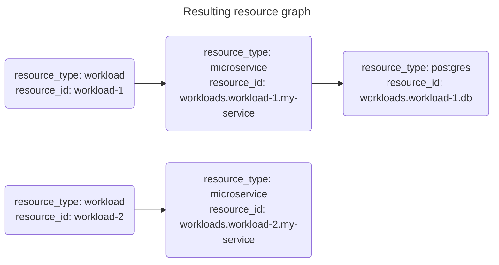

{}

The key distinction here is that manifests allow for a declarative description of the "what" and omit the imperative description of the "how" to reach that state. As such, they provide an abstraction for developers.


A manifest describes the resources requested from the Orchestrator for it to manage per [environment]() of a [project](). The manifest itself is supposed to be environment-agnostic.

The manifest makes no limitation as to the kind of resources it describes. They may be application workloads, infrastructure only, or a combination of the two. The manifest describes whichever parts of your estate you wish to manage via the Orchestrator.

Use a manifest file as an input to a [CLI]() `deploy` command:

```bash
hctl deploy my-project my-environment manifest.yaml
```

## Configuration

A manifest consists of the following sections:

```yaml
# workloads are a logical grouping of resources
workloads:
  sample-workload:
    # Resources that make up the workload. Could be VMs, databases, containers, serverless functions, etc.
    resources:
      db:
        # The resource type to provision
        type: postgres
        # An optional class of the resource to be used in the module rules
        class: standard
        # An optional id of the resource to be used in the module rules
        id: my-postgres-db
        # Optional parameters to pass to the resource. Are mapped into the "module_params" of the resource's module
        params:
          postgres_version: "17"
    # Outputs expose deployment values for use by surrounding processes
    outputs:
      DB_HOST: ${resources.db.outputs.host}
      DB_PORT: ${resources.db.outputs.port}
      DB_USER: ${resources.db.outputs.user}
      DB_PASSWORD: ${resources.db.outputs.password}
      HOSTNAME: ${shared.dns.outputs.hostname}

# Resources shared across workloads
shared:
  dns:
    type: dns
    class: standard
    id: my-dns
```

## Workloads

`workloads` are a logical grouping of resources within the manifest. All resources must be contained within a workload, or otherwise be [`shared` resources](#shared-resources).

Resources may access outputs of another resource through [resource placeholders]() as `${resources.<resource>.outputs.<output>}`, but within the same workload only.

```yaml
workloads:
 sample-workload:
  resources:
    my-service:
      type: microservice
      params:
        # Accessing another resource`s output in the same workload
        db_host: ${resources.db.outputs.host}
    db:
     type: postgres
```

Each workload can have its own set of [resources](#resources) and [outputs](#outputs).

The `workloads` section may be empty:

```yaml
workloads: {}
```

Every workload will become a top level node of resource type `workload` in the [resource graph]() for the deployment based on the manifest:

```yaml
# manifest.yaml
workloads:
  workload-1:
    resources:
      my-service:
        type: microservice
        params:
          db_host: ${resources.db.outputs.host}
      db:
        type: postgres
  workload-2:
    resources:
      my-service:
        type: microservice
```



## Resources

`resources` make up a logical [workload](#workloads). They could represent VMs, databases, containers, serverless functions, etc.

Each resource consists of:

- A `type`
- An optional `class`
- An optional `id`
- An optional set of `params`

```yaml
workloads:
 sample-workload:
  resources:
    db:
      type: postgres
      class: standard
      id: my-postgres-db
      params:
        postgres_version: "17"
```

The `type` and the optional `id` and `class` are used to determine which [module]() to use for provisioning the resource by applying the existing [module rules]().

The resource `params` will be mapped to the `module_params` of the selected module.

Resource `params` in the `workloads` section may access outputs from resources of the same [workload](#workloads) using the `${resources.<resource>.outputs.<output>}` placeholder.

Resource `params` in the `workloads` section may also access outputs from [shared resources](#shared-resources) using the `${shared.<resource>.outputs.<output>}` placeholder.

## Outputs

Workload `outputs` expose deployment values for use by surrounding processes.

E.g. given the manifest on the left, the command `hctl deploy my-project my-environment manifest.yaml --result outputs.yaml` will create a file `outputs.yaml` like shown on the right:



```yaml
# manifest.yaml
workloads:
  sample-workload:
    resources:
      db:
        type: postgres
    outputs:
      DB_HOST: ${resources.db.outputs.host}
      DNS_HOST: ${shared.dns.outputs.hostname}
shared:
  dns:
    type: dns
```

```yaml
# outputs.yaml
sample-workload:
    DB_HOST: some.hostname.com
    DB_PORT: 1234
```



Outputs may reference values from resources of the same [workload](#workloads) using the `${resources.<resource>.outputs.<output>}` placeholder.

Outputs may also reference values from [shared resources](#shared-resources) using the `${shared.<resource>.outputs.<output>}` placeholder.

## Shared resources

Shared resources are shared across all `workloads` of the manifest. They are defined in the optional `shared` section outside of the `workloads` and can be accessed from any `workload` in the manifest.

Like resources in the `workloads` section, each shared resource consists of:

- A `type`
- An optional `class`
- An optional `id`
- An optional set of `params`

```yaml
workloads:
  workload-1:
    resources:
      my-service:
        type: microservice
    outputs:
      HOSTNAME: ${shared.dns.outputs.hostname}
# Resources shared across workloads
shared:
  dns:
    type: dns
    class: standard
    id: my-dns
```

Shared resources are useful for resources that need to be accessed by multiple workloads, such as a shared DNS or a shared cache.

Resources in the `workloads` section may access the outputs of shared resources using the `${shared.<resource>.outputs.<output>}` placeholder.

Shared resources themselves cannot access the outputs of any other resources, neither from the `shared` nor from the `workloads` section.

## Placeholders support in manifests

Manifests support these kinds of placeholders:

- [Context placeholders]() (`${context.<property>}`):
  - In `outputs`
  - In resource `params` in both the `workloads` and `shared` section

- [Resource placeholders]() (`${resources.<resource_id>.outputs.<traversal>}` and `${shared.<resource_id>.outputs.<traversal>}`):
  - In `outputs`
  - In resource `params` within the `workloads` section (not supported in the `shared` section)

## Dynamic replacement of manifest content

> 💡 TIP

You may have to specify values in a manifest that are only known at deploy time, such as the version of an artefact that was just built by a previous CI/CD pipeline step and pushed to an artefact registry as a specific version.

To set such values ad hoc in your deploy flow, you may use this approach.

1. Use static placeholder strings in the manifest like this:

```yaml
# manifest.yaml
workloads:
  sample-workload:
    resources:
      example-package:
        type: example-app-package-type
        params:
          # Replace this value dynamically just before deployment
          build: EXAMPLE_APP_BUILD_VERSION
```

2. Dynamically replace the static placeholder string with the known version just before deploying:

```bash
# Let the known version be available in the KNOWN_VERSION environment variable
sed -i "s/EXAMPLE_APP_BUILD_VERSION/${KNOWN_VERSION}/g" manifest.yaml
```

3. Perform a `hctl deploy` using the altered `manifest.yaml` normally.

## Maintaining a single manifest

We recommend having a single manifest file to describe the desired state of a project and maintaining it like any other source code, i.e. using a VCS like git and requiring CI/CD steps and pull requests adhering to your own standards. This way you will have repeatable, auditable deployments, and a deterministic rollback capability.

There is also the option to have multiple manifests and combine them using the `hctl deploy --merge` flag. This option is useful for experimentation, patching, and hotfix situations, but is not recommended for standard use due to these risks:

- Deployments may be conflicting with each other or run in different directions
- Rollbacks will not be deterministic
- When resources are removed from one manifest, the Orchestrator will tear them down on deployment to keep your resource estate clean. Resources added via a `--merge` may leak and continue to run, adding to your cloud bill

## Moving and renaming resources

These changes to a resource in the manifest will currently cause the real-world resource to be destroyed (Terraform/OpenTofu `destroy`) and re-created:

- Renaming a resource
- Moving a resource to another workload, or to/from the `shared` section
- Renaming the workload (will affect all resources in that workload)

To avoid a destruction, you can ensure that the resource type, class, and id remain identical when making the change. This way the Orchestrator will consider the moved resource to be the same resource as previously, and all real-world resources represented by it will be unaffected.

E.g. to move a resource in a manifest to another workload, which would normally change its resource id, set the resource id to its previous value:

```yaml
workloads:
  one:
    resources:
    # moved:
    #   type: something
  two:
    resources:
      moved:
        type: something
        id: workloads.one.moved # Explicitly set the resource id to the previous value
```


The moved resource may now have a different resource id than other resources underneath the same workload. This may prevent graph lookups from working properly that are using [selector placeholders]() relying on a common resource id in a graph section.


We plan to implement better support for manifest changes in future releases of the Orchestrator.

## Examples

### Single workload with a database

In this example, a developer wants to deploy a workload that needs a PostgreSQL database. The manifest specifies the workload, the database resource, and the outputs needed to connect to the database.

```yaml
workloads:
  sample-workload:
    outputs:
      DB_HOST: ${resources.db.outputs.host}
      DB_PORT: ${resources.db.outputs.port}
      DB_USER: ${resources.db.outputs.user}
      DB_PASSWORD: ${resources.db.outputs.password}

    resources:
      db:
        type: postgres
        class: standard
        id: my-postgres-db
        params:
          postgres_version: "16"
```

The deployment of this manifest will result in the provisioning of a PostgreSQL database with the specified parameters, and the workload will be configured with the connection details to access the database.

### Multiple workloads with shared resources

In this example, a developer wants to deploy two workloads that share a DNS resource. Each workload has its own database and route resources.

```yaml
workloads:
  workload-one:
    outputs:
      DB_CONNECTION_STRING: ${resources.db.outputs.connection_string}
      HOSTNAME: ${shared.dns.outputs.hostname}
    resources:
      db:
        type: postgres
        class: standard
        id: my-postgres-db
        params:
          postgres_version: 17
      route:
        type: route
        params:
          hostname: ${shared.dns.outputs.hostname}
          port: 80
          path: /workload-one

  workload-two:
    outputs:
      DB_CONNECTION_STRING: ${resources.db.outputs.connection_string}
      HOSTNAME: ${shared.dns.outputs.hostname}
    resources:
      db:
        type: postgres
        class: standard
        id: my-postgres-db
        params:
          postgres_version: 17
      route:
        type: route
        params:
          hostname: ${shared.dns.outputs.hostname}
          port: 80
          path: /workload-two
shared:
  dns:
    type: dns
```

In this case, the deployment of the manifest will result in the provisioning of two databases and routes and a shared DNS record. Each workload will be configured with the connection details to access its database and know the respective DNS hostname.
