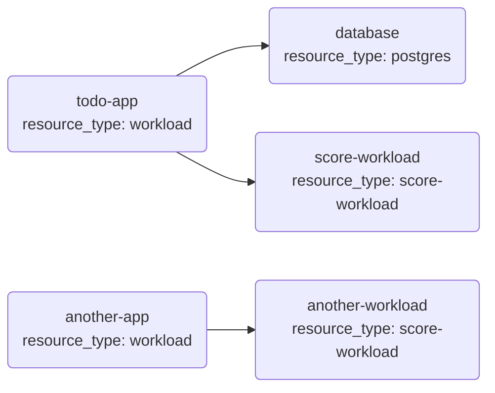
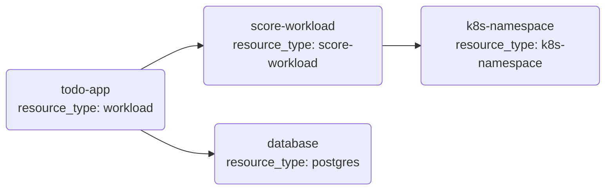
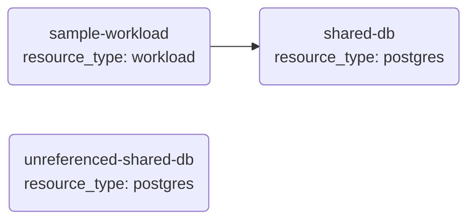
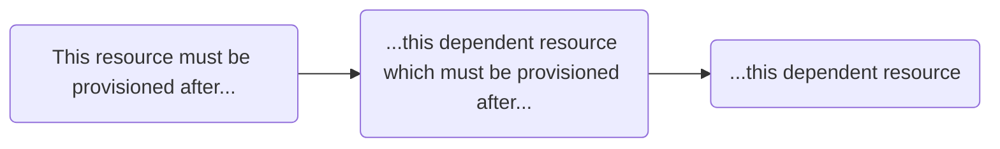
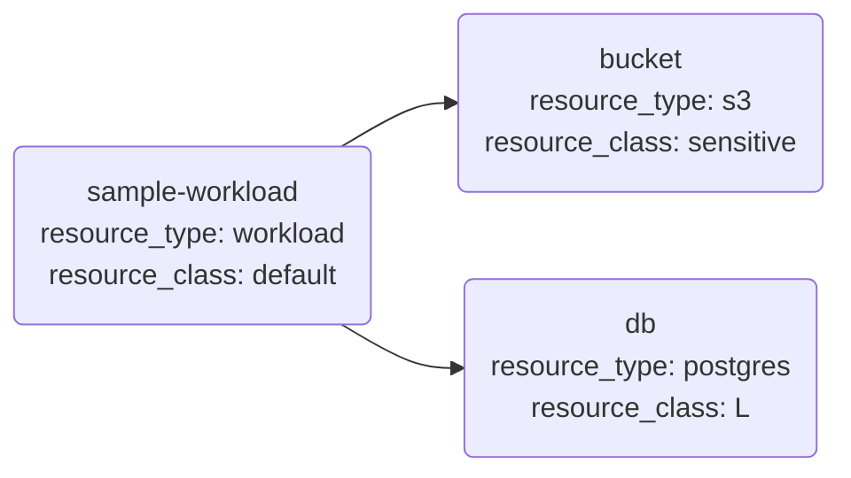
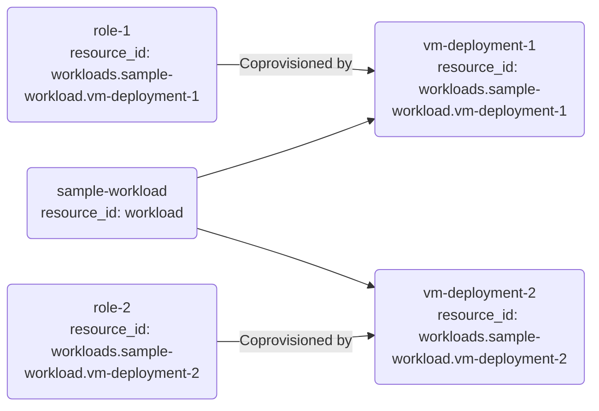
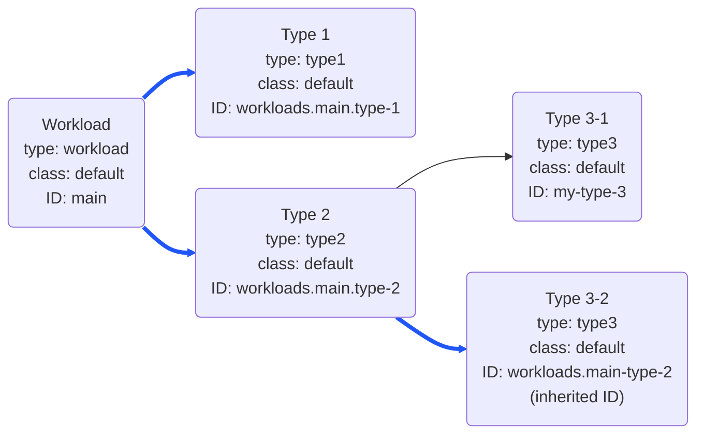

{}

You will find a visual rendering of the resource graph in the Orchestrator [console](https://console.humanitec.dev) for each environment that has a deployment. It may look like this:


You can hold and drag nodes to rearrange them in the console view, and click on any node to see its details.

The Orchestrator constructs a resource graph for every new [deployment](), starting from the [manifest]() being used and expanding it according to the setup of the modules as shown on this page.

The resource graph is _directed_ and _acyclic_. Any configuration creating a cycle will cause the graph generation, and therefore the deployment, to fail.

## Workloads and resources

All `workloads` in a manifest become root nodes in the graph. All child `resources` become dependent nodes of their parent `workload`.


```yaml
# Manifest with one workload
# and two dependendent resources
workloads:
  todo-app:
    resources:
      database:
        type: postgres
      score-workload:
        type: score-workload
  another-app:
    resources:
      another-workload:
        type: score-workload
```




Each node represents an "active resource" of a specific [resource type]() and is based on a [module]().

The module used by an active resource may cause more nodes to be added to the graph by defining module [dependencies]() or [coprovisioned resources]().

This `dependencies` declaration in a module...

```
resource "platform-orchestrator_module" "score_workload" {
  resource_type = "score-workload"
  dependencies = {
    namespace = {
      type = "k8s-namespace"
    }
  }
  # ...
}
```

... causes another resource of type `k8s-namespace` to be added to the graph.



The resource graph may therefore contain more nodes than there are elements defined in the manifest.


The ability to extend the deployment beyond the directly requested resources is one of the core features of the Orchestrator. It lets platform engineers provide useful abstractions for developers and make the Orchestrator automatically provision standardized sets of resources.


## Shared resources

[Shared resources]() from the manifest are basically added as root nodes to the graph. In practice, they will usually be referenced by another element like in this manifest, creating an edge between the two nodes.


```yaml
# Sample manifest
workloads:
  sample-workload:
    outputs:
      # Referencing the shared-db resource
      DB_HOST: ${shared.shared-db.outputs.host}
shared:
  # This shared resource is being referenced
  shared-db:
    type: postgres
  # This shared resource is not referenced
  unreferenced-shared-db:
    type: postgres
```




## Graph dependencies

An edge in the graph represents a dependency between two resources and has a direction.

A dependent resource must be provisioned _before_ the depending resource. Dependencies inform the [construction of the Terraform/OpenTofu module for a deployment]().



These mechanisms create edges in the graph:

- Referencing the `outputs` of a resource in the [manifest]()
- Referencing the `outputs` of a resource in a [module]() using [placeholders]()
- Referencing the `outputs` of a resource in a [provider]() using [placeholders]()
- Having [`dependencies` in modules]()
- Having [`coprovisioned` resources in modules]() (these may or may not add edges depending on the flags for each `coprovisioned` resource)

## Terraform/OpenTofu dependency graph

Working with a dependency graph is also a core concept for [Terraform](https://developer.hashicorp.com/terraform/internals/graph) and [OpenTofu](https://opentofu.org/docs/internals/graph/). The Orchestrator resource graph is not identical to that graph, though the two are related.

During a deployment, the Orchestrator constructs the resource graph first and then converts this internally into a Terraform/OpenTofu ("TF") file (see [what happens during a deployment]()) using the TF code referenced in the modules for each node. The TF executable then builds a dependency graph when running `plan` or `apply` on that file via a [runner]().

Since an Orchestrator module may contain any number of TF resources, the TF dependency graph will usually be more fine-grained than the Orchestrator resource graph. Also, the Orchestrator resource graph nodes are typed using the [resource types]() defined on the Orchestator level such as `postgres`, whereas the TF resources are typed using those resources that the TF provider(s) define such as `aws_db_instance`.

## Active resources

Each node in the resource graph represents an active resource. You can query the details of all active resources in an environment by selecting a node in the console view or by using this command:

```bash
octl get active-resource-nodes my-project my-environment -o yaml # or "-o json" for JSON output
```

The properties of each active resource include its resource type, its project, environment, and deployment, as well as the module used to provision it.

Each active resource also has a [resource class](#resource-class) and [resource ID](#resource-id). Find more details on these properties further down.

### Resource uniqueness

{}

## Resource class

Every active resource has a resource class. If not specified otherwise when requesting the resource, the class is `default`.

Resource classes provide a way of optionally providing different flavors of a resource type in your platform.

### Example: bucket classes

There might be multiple flavors of S3 bucket available:

- An `external` S3 bucket that is open to the public internet, e.g. to allow for downloading of assets
- A `sensitive` S3 bucket that is encrypted and only accessible via a limited set of roles, e.g. for storing confidential data
- A `volatile` S3 bucket with a retention time is less than 24 hours, e.g. for holding intermediate data from other processes

To make these classes available, platform engineers configure a [module]() and a corresponding [module rule]() matching a `class`. There is no standalone resource class definition.

```hcl
# Module rule mapping the "sensitive" class to a particular S3 bucket module
resource "platform-orchestrator_module_rule" "s3-sensitive" {
  module_id      = platform-orchestrator_module.s3_sensitive.id
  resource_class = "sensitive"
}
```

The module referenced in the `module_id` will then have to implement this class appropriately, in this case by configuring the S3 bucket to be as "sensitive" as required.

### Example: database sizes

There might be multiple sizes of PostgreSQL databases available: `S`, `M`, `L`, and `XL`. Each class may define a different storage size, vCPU allocation, and other parameter settings that make up a size class.

### Using resource classes in manifests

With module and module rule in place, developers can request a specific `class` of a resource alongside the `type` in a manifest.


```yaml
# Manifest requesting an S3 bucket
# and a postgres database
# of a particular class
workloads:
  sample-workload:
    resources:
      bucket:
        type: s3
        class: sensitive
      db:
        type: postgres
        class: L
```





### Using resource classes in modules

Platform engineers can also use resource classes when expanding the resource graph through [module `dependencies`]() or [module `coprovisioning`]():


```hcl
# Using a resource class in a dependency
resource "platform-orchestrator_module" "some_module" {
  # ...
  dependencies = {
    postgres = {
      type  = "s3"
      class = "sensitive"
    }
  }
}
```

```hcl
# Using a resource class in coprovisioning
resource "platform-orchestrator_module" "some_module" {
  # ...
  coprovisioned = [
    {
      type  = "s3"
      class = "sensitive"
    }
  ]
}
```


See [resource classes in dependencies]() for more options when working with classes.

## Resource ID

Every active resource has a resource ID. Unless specified otherwise, the resource ID is:

- The workload name for a `workload` in the manifest
- `workloads.<workload-name>.<resource-name>` for the `resources` of a workload in the manifest
- The inherited resource ID of the parent resource for any resource created via [module `dependencies`]() or [module `coprovisioning`]()
- `shared.<resource-name>` for the `shared-resources` in the manifest

Resource IDs serve to structure the resource graph into logical sub-segments through a common ID, or help uniquely identify a particular resource.


Working with resource IDs is an advanced pattern you may not need to use for most scenarios.


{}

### Example: inherited resource ID

Given this manifest...

```yaml
workloads:
  sample-workload:
    resources:
      vm-deployment-1:
        type: vm-deployment
      vm-deployment-2:
        type: vm-deployment
```

... and the module for the `vm-deployment` coprovisioning a dependent `role` resource:

```hcl
resource "platform-orchestrator_module" "vm_deployment" {
  id            = "vm-deployment"
  coprovisioned = [
    {
      type                    = "role"
      is_dependent_on_current = true
    }
  ]
  # ...
}
```

The resource graph will look like this:



Note that the `role` resources have each inherited the resource ID from the coprovisioning `vm-deployment` resource.

### Example: segmenting the graph through ID inheritance

Given this resource graph where the two highlighted resources share the same resource ID through inheritance:



Here, the module for `type1` can use a [selector placeholder]() to look up only the `type3` resource having the inherited ID of its `type2` parent by using the `@` ("same") symbol:

```
${select.consumers('workload').dependencies('type2').dependencies('type3#@').outputs.some_output}
```

See [resource IDs in dependencies]() for more options when working with IDs.

## Resource uniqueness

{}

## Reading and passing values between resources

Resources may read outputs from other resources in the graph by using [resource placeholders]() and [selector placeholders]().

Resources may pass values to other resources through resource `params` in [module `dependencies`]() or [module `coprovisioning`]().
