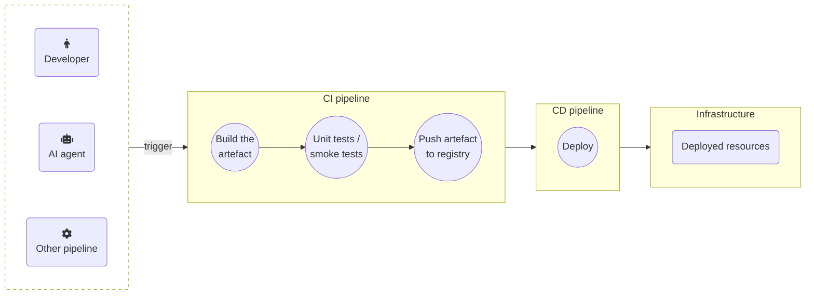
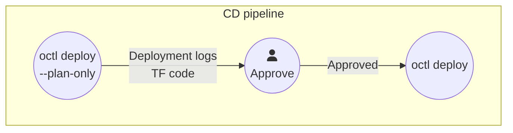

> Relevant tools: GitHub, Jenkins, GitLab, Azure DevOps, and others

{}

## Integrations overview





Adjustments will probably have to be made around the "deploy" parts of your CD/CD workflows when integrating the Orchestrator. They may actually simplify them.

All other parts of your CI/CD workflows generally remain unchanged. In particular, CI pipelines continue to build and push artefacts to your registries as before, to be used only during [deployment](#artefact-registries).

CI/CD setups vary greatly between organizations, but there are some common patterns.

## Continuous deployment

If you are building and deploying continuously, then a CD pipeline or pipeline step is usually triggered to deploy a newly built artefact to the target environment similar to this flow:



Perform these modifications to deploy your resources via the Platform Orchestrator:

1. Prepare a [service user]() with appropriate permissions to deploy into the target environments, and place its authentication token in a secret accessible to the pipeline. Check the documentation of your pipeline tool for details
2. Add a [manifest]() file to the repository running the pipeline, specifying all the required resources that make up a deployment
3. Modify the "Deploy" step(s) of the pipline to deploy via the Plaform Orchestrator

Doing so involves changing some or all deployment steps to execute a single `deploy` command using the [`octl` CLI](). This is a sample implementation as a GitHub workflow:



Find more options for the `octl deploy` command [here]().

The manifest may contain dynamic elements for greater flexibility in your workflow. Refer to [placeholders support]() and [dynamic replacement]() to see how.

## Receiving outputs

If your manifest defines [outputs](), add the `--result` flag to the `octl deploy` command in your pipeline to capture them. Then use the outputs in subsequent pipeline steps like this (using GitHub workflows as an example):

```yaml
jobs:
  example:
    # ...
    steps:
    - name: Deploy a manifest and capture outputs
      run: octl deploy my-project my-environment ./manifest.yaml --result outputs.yaml
    - name: Use outputs
      run: |
        # Use outputs.yaml to perform any post-deployment steps
```

## Obtaining deployment logs

Your pipeline steps may need to access the log output of a `octl deploy` command. See [returning deployment logs securely]() for instructions to embed in your pipeline.

## Viewing the generated TF code

Your pipeline steps may need to access the TF code that was generated for a deployment. Use the `octl get tf` command following a deployment step like this (using GitHub workflows as an example):

```yaml
jobs:
  example:
    # ...
    steps:
    - name: Deploy
      run: octl deploy my-project my-environment manifest.yaml
    - name: View TF code
      run: |
        export LATEST_DEPLOY_ID=$(octl get deployments my-project my-environment -o yaml | yq -r '.[0].id')
        octl get tf $LATEST_DEPLOY_ID > tf-output.tf
```

See [viewing the generated TF code]() for more details on this operation.

## Environment promotion

A common CI/CD use case often executed by pipelines is promoting the deployment state from one environmnent to the next, e.g. from `development` to `staging`.

With the Orchestrator, build your pipeline to obtain the `octl` CLI as shown above and have it then execute this single command (using GitHub workflows as an example):

```yaml
jobs:
  example:
    # ...
    steps:
    - name: Promote from development to staging
      run: octl deploy my-project staging environment://development
```

Find more variations for environment promotion using the `octl deploy` command [here]().

## Approvals

A common CI/CD use case is requesting approval before proceeding to the next pipeline step, usually performed by a human. This functionality remains in your CI/CD tooling with the Orchestrator providing input to make the decision.

For example, your pipeline may perform a `--plan-only` deployment, [produce deployment logs](#obtaining-deployment-logs) and/or the [TF output](#viewing-the-generated-tf-code), request an approval, and then proceed to execute the deployment.


