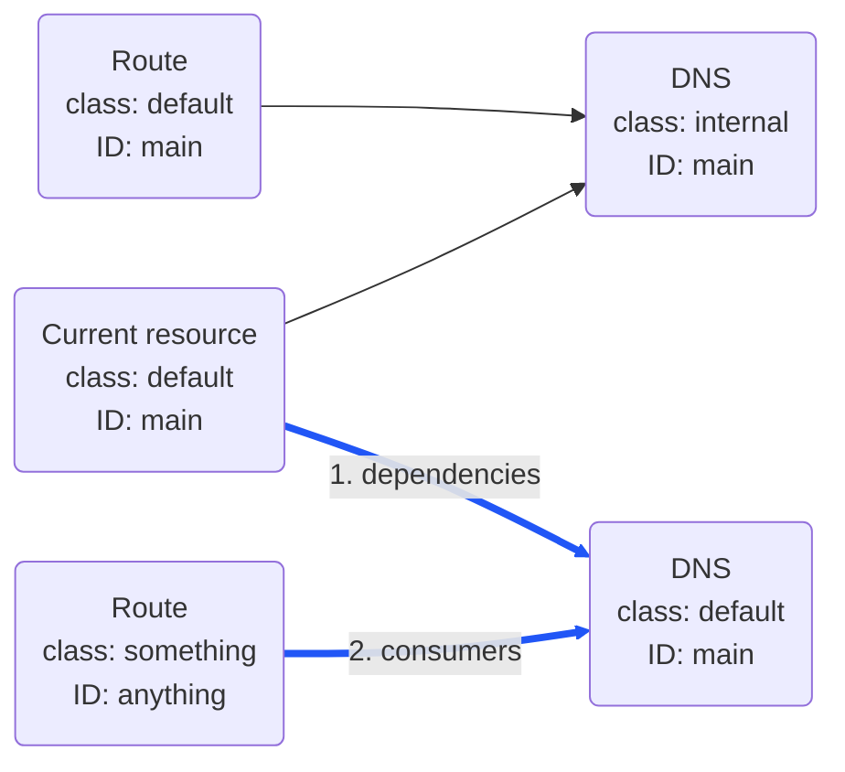
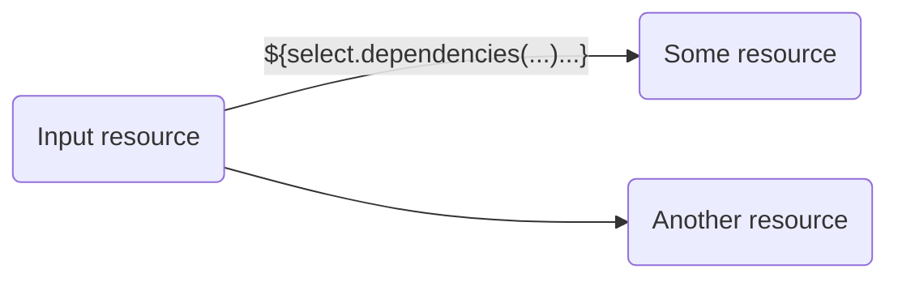
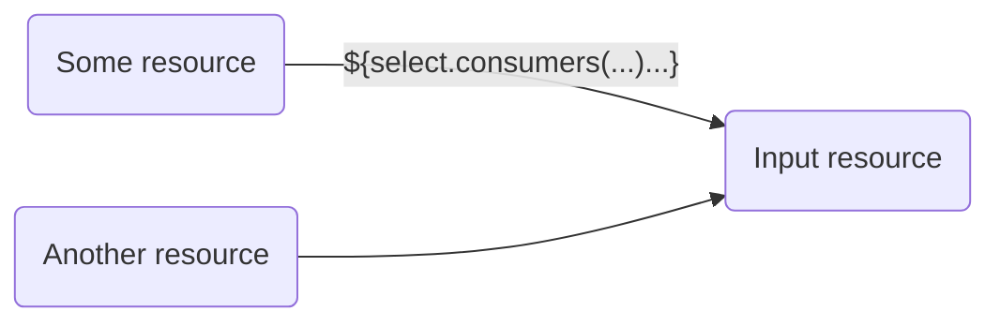
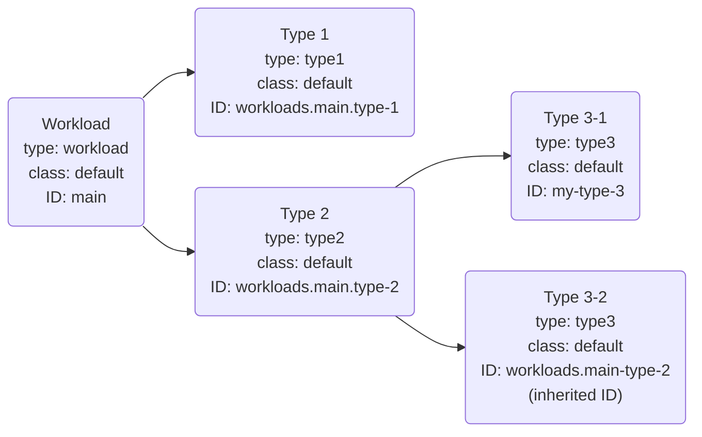

_Placeholder expressions_ let you add dynamic elements into the configuration of the Platform Orchestrator.

Placeholder expressions are identified through their `${` prefix and `}` suffix and follow a strict syntax as shown on this page, e.g. `${context.env_id}` for "the ID of the current environment".


When used in Terraform/OpenTofu code, placeholder expressions must be preceded by a double `$$`, e.g. `$${context.env_id}`.


Note that not all locations support all kinds of placeholders. Errors will be thrown if the placeholder is not supported or cannot be resolved. Refer to the list below to see which placeholder expression may be used where and find more usage details in the sections further down.



## List of placeholders

| Placeholder expression                           | Usable in                                                                                                                                                                                                                                                                                                                                                                                                                                                                         | Description                                                                                    |
| ------------------------------------------------ | --------------------------------------------------------------------------------------------------------------------------------------------------------------------------------------------------------------------------------------------------------------------------------------------------------------------------------------------------------------------------------------------------------------------------------------------------------------------------------- | ---------------------------------------------------------------------------------------------- |
| `${context.env_id}`                              | [Manifest]():<br/><ul><li> `outputs`</li><li>resource `params`</li></ul>[Module]():<ul><li> `module_inputs`</li><li> `params` in `dependencies`</li><li> `params` in `coprovisioning`</li></ul>[Provider]():<ul><li> `configuration`</li></ul>                                | The environment ID of the current deployment [(details)](#context-placeholders)                |
| `${context.env_type_id}`                         | [Manifest]():<br/><ul><li> `outputs`</li><li>resource `params`</li></ul>[Module]():<ul><li> `module_inputs`</li><li> `params` in `dependencies`</li><li> `params` in `coprovisioning`</li></ul>[Provider]():<ul><li> `configuration`</li></ul>                                | The environment type ID of the current deployment [(details)](#context-placeholders)           |
| `${context.org_id}`                              | [Manifest]():<br/><ul><li> `outputs`</li><li>resource `params`</li></ul>[Module]():<ul><li> `module_inputs`</li><li> `params` in `dependencies`</li><li> `params` in `coprovisioning`</li></ul>[Provider]():<ul><li> `configuration`</li></ul>                                | The organization ID of the current deployment [(details)](#context-placeholders)               |
| `${context.project_id}`                          | [Manifest]():<br/><ul><li> `outputs`</li><li>resource `params`</li></ul>[Module]():<ul><li> `module_inputs`</li><li> `params` in `dependencies`</li><li> `params` in `coprovisioning`</li></ul>[Provider]():<ul><li> `configuration`</li></ul>                                | The project ID of the current deployment [(details)](#context-placeholders)                    |
| `${context.res_class}`                           | [Module]():<ul><li> `module_inputs`</li><li> `params` in `dependencies`</li><li> `params` in `coprovisioning`</li></ul>                                                                                                                                                                                                                                                                                    | The resource class of the resource [(details)](#context-placeholders)                          |
| `${context.res_id}`                              | [Module]():<ul><li> `module_inputs`</li><li> `params` in `dependencies`</li><li> `params` in `coprovisioning`</li></ul>                                                                                                                                                                                                                                                                                    | The resource ID of the resource [(details)](#context-placeholders)                             |
| `${context.res_type}`                            | [Module]():<ul><li> `module_inputs`</li><li> `params` in `dependencies`</li><li> `params` in `coprovisioning`</li></ul>                                                                                                                                                                                                                                                                                    | The resource type of the resource [(details)](#context-placeholders)                           |
| `${resources.<alias>.outputs.<traversal>}`       | [Manifest]():<br/><ul><li> `outputs`</li><li>resource `params` (only in `workloads` section)</li></ul> [Module]():<ul><li> `module_inputs`</li><li> `params` in `dependencies`</li><li> `params` in `coprovisioning`</li></ul>[Provider]():<ul><li> `configuration`</li></ul> | Extract outputs from a resource [(details)](#resource-placeholders)                            |
| `${select.<function chain>.outputs.<traversal>}` | [Module]():<ul><li> `module_inputs`</li><li> `params` in `dependencies`</li><li> `params` in `coprovisioning`</li></ul>                                                                                                                                                                                                                                                                                    | Extract outputs from multiple nodes in the resource graph [(details)](#selector-placeholders)  |
| `${self.outputs.<traversal>}`                    | [Module]():<ul><li> `params` in `coprovisioning`</li></ul>                                                                                                                                                                                                                                                                                                                                                 | Extract outputs from the current resource [(details)](#self-placeholders)                      |
| `${shared.<alias>.outputs.<traversal>`           | [Manifest]():<br/><ul><li> `outputs`</li><li>resource `params` (only in `workloads` section)</li></ul>                                                                                                                                                                                                                                                                                                               | Extract outputs from a shared resource [(details)](#resource-placeholders-in-manifests)        |
| `${var.<variable>}`                              | [Provider]():<ul><li> `configuration`</li></ul>                                                                                                                                                                                                                                                                                                                                                                   | Use values from `TF_VAR_<variable>` style environment variables [(details)](#var-placeholders) |

## Context placeholders

These placeholders allow the behavior or results of a deployment or a module to change depending on its context.

The following context placeholders are available in the deployment [manifest](), [module inputs](), and resource parameters (`params`) in [dependencies]() or [coprovisioning]():

- `${context.org_id}` - The organization ID
- `${context.project_id}` - The [project]() ID
- `${context.env_id}` - The [environment]() ID
- `${context.env_type_id}` - The [environment type]() ID

The following context placeholders are more restrictive and only accessible within the definition of a module since they require knowledge of the resource graph node being provisioned. Specifically, they can be used in [module inputs]() and resource parameters (`params`) in [dependencies]() or [coprovisioning]():

- `${context.res_type}` - The [resource type]() of the resource provisioned by this module
- `${context.res_class}` - The [resource class]() of the resource. The default value is "default" but may be different if specified on resource creation
- `${context.res_id}` - The [resource ID]() of the resource. This depends on the location of the resource, whether the ID was set specifically or inherited


When used as `params` in `dependencies`, context placeholders will resolve to the value of the _dependent_ (child) resource.

When used as `params` in `coprovisioning`, context placeholders will resolve to the value of the _coprovisioned_ resource.


## Resource placeholders

The syntax of a resource placeholder is of the form `${resources.<alias>.outputs.<traversal>}`, e.g.

```yaml
${resources.my-resource.outputs.something.key}
```

This resource placeholder refers to the `key` field in the `something` output of the resource defined by the `my-resource` alias in the module.

An error will be thrown if no resource is specified by the alias or if the traversal cannot be resolved.

### Resource placeholders in manifests

Resource placeholders may be used in [manifests]() to refer to outputs of resources defined elsewhere in the manifest.

A resource placeholder may populate resource `params` or `outputs` in the `workloads` section of the manifest. See the [manifests]() page for more details on these sections.

```yaml
# manifest.yaml
workloads:
  my-workload:
    resources:
      my-service:
        type: microservice
        params:
          db_host: ${resources.db.outputs.host}
      db:
        type: postgres
    outputs:
      DB_PORT: ${resources.db.outputs.port}
```

A variation of resource placeholders exists in manifests to refer to `shared` resources. The placeholder format is then `${shared.<alias>.outputs.<traversal>}`:

```yaml
workloads:
  my-workload:
    outputs:
      # Resource placeholder for a shared resource
      HOSTNAME: ${shared.dns.outputs.hostname}
shared:
  dns:
    type: dns
```

### Resource placeholders in modules

Resource placeholders may be used in [modules]() to refer to outputs of any resource defined in the module `dependencies` section. The outputs may then be used as [module inputs]() as well as in `params` to other resources in the [dependencies]() or [coprovisioning]() section of the module:


{}

```hcl
  dependencies = {
    some-resource = {
      type = "some-resource-type"
    }
    another-resource = {
      type = "another-resource-type"
      params = jsonencode({
        # Resource placeholder referring to the output "x" of the resource aliased as "some-resource"
        some-param = "$${resources.some-resource.outputs.x}"
      })
    }
  }
```

{}
{}

```yaml
dependencies:
  some-resource:
    type: some-resource-type
  another-resource:
    type: another-resource-type
    params:
      # Resource placeholder referring to the output "x" of the resource aliased as "some-resource"
      some-param: "${resources.some-resource.outputs.x}"
```

{}


The resource placeholder first refers to the resource alias, `some-resource` in the example, which is the key of the resource in the `dependencies` section and only used locally in the module. The resource placeholder then defines the output value to reference, `x` in the example.

### Resource placeholders in providers

Resource placeholders may be used in [provider]() configuration when the provider is used by a module that defines an appropriately named [dependency]() resource. E.g. the "some-module" module below declares a dependency to a resource aliased `my-resource`, and the provider can use the alias in a resource placeholder:


{}

Module:

```hcl
resource "platform-orchestrator_module" "some-module" {
  # ...
  dependencies = {
    my-resource = {
      type = "something"
    }
  }
  provider_mapping = {
    example = "example.default"
  }
}
```

Provider:

```hcl
resource "platform-orchestrator_provider" "example-default" {
  provider_type = "example"
  id            = "default"
  # ...
  configuration = jsonencode({
    key = "$${resources.my-resource.outputs.key}"
  })
}
```

{}
{}

Module:

```yaml
...
dependencies:
  my-resource:
    type: something
provider_mapping:
  example: example.default
```

Provider:

```yaml
provider_type: example
id: default
...
configuration:
  key: ${resources.my-resource.outputs.key}
```

{}


This is used to avoid duplicating the module and provider for small configuration changes. Go [here]() for a complete example.

## Selector placeholders

Selector placeholders are an advanced concept used in [modules]() that allow extracting outputs from multiple nodes in the resource graph at the same time. The outputs may then be used as [module inputs]() as well as in `params` to other resources in the [dependencies]() or [coprovisioning]() section of the module.

The selector uses a chain of functions to traverse the graph. It starts at the resource node defined by the current module, this being the input to the first function in the chain. It then passes the resources found by each function to the next function in the chain which evaluates them one by one.

The syntax of a selector placeholder is `${select.<function chain>.outputs.<traversal>}`, e.g.

```yaml
${select.dependencies('dns.default#@').consumers('route').outputs.name}
```

This selector placeholder

1. Selects all `dependencies` of the current resource which have the resource type `dns`, class `default`, and the same (`@`) resource ID as the current resource
2. Selects all `consumers` of the resources from step 1. which have a resource type `route`, regardless of class and ID



The following functions are supported:

- [dependencies](#selector-function-dependencies)
- [consumers](#selector-function-consumers)

### Data types for selector placeholders

A selector placeholder always returns an array with zero (`[]`) or more items as a result.

The Terraform/OpenTofu `variable` receiving the result of a selector must therefore be of a matching collection type (`list`, `set`, `tuple`) or `any`.


{}

```hcl
# Example module showing the data type usage for selector placeholders
resource "platform-orchestrator_module" "my-module" {
  # ...
  module_inputs = jsonencode({
    # Using a selector placeholder to populate a variable
    input_from_selector = "$${select.dependencies('some-type').outputs.some-output}"
  })
  module_source = "inline"
  module_source_code = <<EOT
# This variable receives the input from the selector and must be of a matching collection type
variable "input_from_selector" {
  type = list(string) # ⬅️⬅️
}
# ... remaining TF code
EOT
}
```

{}
{}

```yaml
# Example module showing the data type usage for selector placeholders
# ...
module_inputs:
  # Using a selector placeholder to populate a variable
  input_from_selector: ${select.dependencies('some-type').outputs.some-output}
module_source: inline
module_source_code: |
  # This variable receives the input from the selector and must be of a matching collection type
  variable "input_from_selector" {
    type = list(string) # ⬅️⬅️
  }
  # ... remaining TF code
```

{}


When the result of a resource selector is passed to a [module param](), the module param needs to be of type `string`, while the corresponding TF variable still is of the collection type:


{}

```hcl
resource "platform-orchestrator_module" "my-module" {
  # ...
  resource_type = "my-type"
  module_params = {
    input_from_selector = {
      type = "string" # ⬅️⬅️
    }
  }
  module_source = "inline"
  module_source_code = <<EOT
variable "input_from_selector" {
  type = list(string) # ⬅️⬅️
}
# ... remaining TF code
EOT
}
```

This other module passes the result of a resource selector into that param while coprovisioning a resource of the above type:

```hcl
resource "platform-orchestrator_module" "my-other-module" {
  # ...
  coprovisioned = [
    {
      type = "my-type"
      params = jsonencode(
        {
          input_from_selector = "$${select.dependencies('something').outputs.some-output}" # ⬅️⬅️
        }
      )
    },
  ]
}
```

{}
{}

```yaml
# ...
resource_type: my-type
module_params:
  input_from_selector:
    type: string # ⬅️⬅️
module_source: inline
module_source_code: |
  variable "input_from_selector" {
    type = list(string) # ⬅️⬅️
  }
  # ... remaining TF code
```

This other module passes the result of a resource selector into that param while coprovisioning a resource of the above type:

```yaml
# ...
coprovisioned:
  - type: my-type
    params:
      input_from_selector: ${select.dependencies('something').outputs.some-output} # ⬅️⬅️
```

{}



### Selector function "dependencies"

The `dependencies` function selects all nodes in the resource graph on which the input nodes depend and that match the filter. Only direct dependencies are considered.



The function requires a filter which must be surrounded by single quotes: `dependencies('filter')`. The filter must start with the resource type to match followed by optional class and ID filters. The class filter is prefixed with a `.`. The ID filter must be at the end and is prefixed with a `#`.

Examples:

- `dependencies('type-a')` will filter for all direct dependencies with resource type `type-a`, regardless of class or ID
- `dependencies('type-a.default')` will constrain the selection to only those resources with class `default`, regardless of ID
- `dependencies('type-a#workloads.example.dep')` will constrain the selection to only resources with the ID `workloads.example.dep`, regardless of class

An `@` symbol may be used to insert the current resource's class or ID:

- `dependencies('type-a.@#@')` will filter for only the node with resource type `type-a` and exactly the class and ID of the current resource node for which this expression is evaluated

### Selector function "consumers"

The `consumers` function selects all nodes in the resource graph that depend on the input nodes and that match the filter. Only direct dependencies are considered.



The function requires a filter which must be surrounded by single quotes: `consumers('filter')`. The filter operates exactly the same way as the filter parameters in the [dependencies](#selector-function-dependencies) function above.

### The "@" symbol in a function chain

A `@` symbol is resolved locally for each function in a function chain. It refers to the resource node that is currently being handled by the function. Further down in the chain, this will not be the resource in whose module the selector is declared.

E.g. in this selector

```yaml
${select.dependencies('dns.default#@').consumers('route.@').outputs.name}
```

the `@` symbol is resolved like this:

- `dependencies('dns.default#@')` handles the resource of the current module, so the `@` resolves to the ID of the resource in whose module this selector is defined
- `consumers('route.@')` handles the `dns` resource(s) found via the `dependencies` function, so the `@` resolves to the class of the `dns` resource currently being handled

### Examples

Given this resource graph:



This placeholder in the the `type2` module returns an array with two elements being the `some_output` values of both `type3` resources:

```yaml
${select.dependencies('type3').outputs.some_output}
```

This placeholder in the `type1` module returns an array with one element being the `some_output` value of the `type3` resource with ID `my-type-3`:

```yaml
${select.consumers('workload').dependencies('type2').dependencies('type3#my-type-3').outputs.some_output}
```

This modification of the same placeholder now returns the value of the `type3` resource with ID `workloads.main.type-2` instead by using the `@` symbol which is evaluated for the `type2` resource:

```yaml
${select.consumers('workload').dependencies('type2').dependencies('type3#@').outputs.input_echo}
```

## Self placeholders

Self placeholders let you use outputs from the current resource to pass them to [co-provisioned resources]() in their `params`:


{}

```hcl
resource "platform-orchestrator_module" "example" {
  # ...
  coprovisioned = [
    {
      type = "some-resource-type"
      params = jsonencode({
        # Using a self placeholder
        key = "$${self.outputs.some-output}"
      })
      # The co-provisioned resource will depend on the current resource due to the self placeholder
      # regardless of "is_dependent_on_current" being set to true or false
      is_dependent_on_current = true
    }
  ]
}
```

{}
{}

```yaml
coprovisioned:
- type: some-resource-type
  params:
    # Using a self placeholder
    key: ${self.outputs.some-output}
    # The co-provisioned resource will depend on the current resource due to the self placeholder
    # regardless of "is_dependent_on_current" being set to true or false
    is_dependent_on_current: true
```

{}


Using a self placeholder removes the need for the co-provisioned resource to locate the co-provisioning resource (e.g. through a [selector placeholder]()) to obtain output values from it.

Using a self placeholder always lets the co-provisioned resource depend on the current resource, even when `is_dependent_on_current` is set to `false` in the `coprovisioned` block.


## Var placeholders

Normally, Terraform/OpenTofu cannot easily be configured by environment variables. Variables must first be set by `variable` blocks and then set through `TF_VAR_` prefixes or `-var` at execution time.

If you specify a `${var.<variable>}` placeholder, the Platform Orchestrator will automatically create the relevant `variable` definition and allow it to be set from the runner.

You may only use var placeholders in provider configuration.

### Example

The `aws` provider can be configured through many environment variables, but these variables may overlap with those used by other AWS related providers and state storage modes. When you set `AWS_SECRET_ACCESS_KEY` this may affect more than the specific provider being configured.

Instead, you can set a more explicit `var` placeholder:


{}

```hcl
resource "platform-orchestrator_provider" "aws" {
  id            = "default"
  provider_type = "aws"
  source        = "hashicorp/aws"
  configuration = jsonencode({
    region     = "us-west-2"
    access_key = "$${var.DEFAULT_AWS_ACCESS_KEY_ID}"
    secret_key = "$${var.DEFAULT_AWS_SECRET_ACCESS_KEY}"
  })
}
```

{}
{}

```yaml
provider_type: aws
id: default
source: hashicorp/aws
configuration:
  region: us-west-2
  access_key: ${var.DEFAULT_AWS_ACCESS_KEY_ID}
  secret_key: ${var.DEFAULT_AWS_SECRET_ACCESS_KEY}
```

{}


You can then set the environment variables `TF_VAR_DEFAULT_AWS_ACCESS_KEY_ID` and `TF_VAR_DEFAULT_AWS_SECRET_ACCESS_KEY` in the runner configuration.
